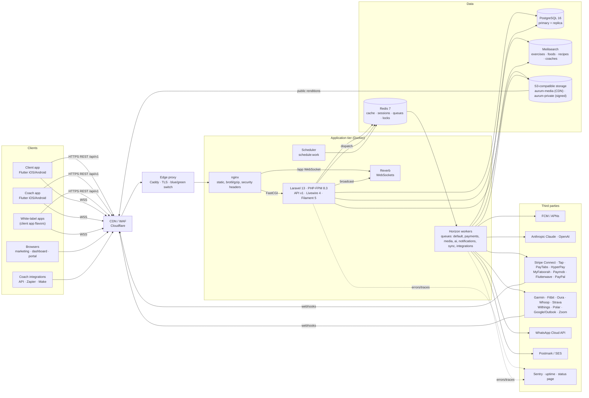
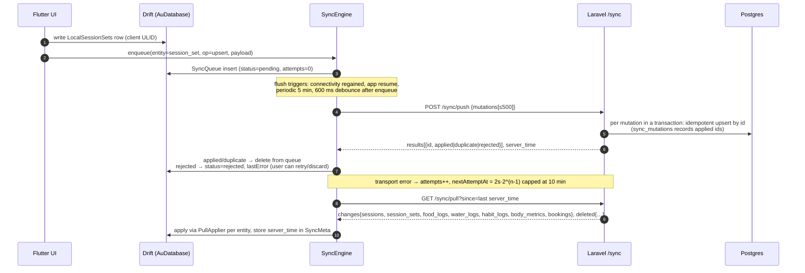
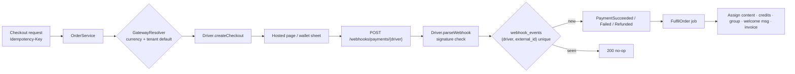
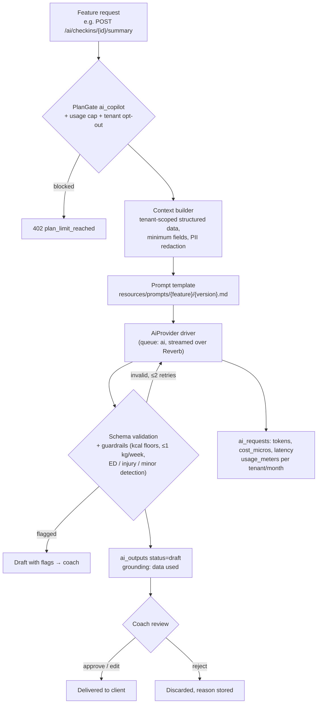
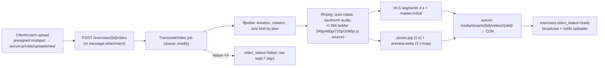

# Aurum — System Architecture

> Decisions are recorded as ADRs in [`docs/adr`](adr). This document explains how the pieces
> fit; the ADRs explain why. Data model: [ERD.md](ERD.md). API: [openapi.yaml](openapi.yaml).

## 1. System context



Request path: client → Cloudflare (WAF, cache for marketing pages and public media) → Caddy
(TLS, active colour) → nginx (static files, compression, headers) → PHP-FPM (Laravel). Octane
(FrankenPHP) is the planned throughput upgrade once the code base is verified stateless under
Octane; the container layout does not change (ADR 0001 §Consequences).

## 2. Repository & module boundaries

```
backend/                     Laravel 13 (PHP 8.3)
  app/Domain/{Module}/       Models · Services · Actions · Events · Listeners · Jobs · Gateways · Data
  app/Http/Api/V1/{Module}/  thin controllers, FormRequests, Resources (envelope via ApiController)
  app/Livewire/{Area}/       web UI (dashboard, portal, marketing islands)
  app/Filament/              super-admin
  routes/api.php             API v1 (source of truth for paths)
  routes/web/*.php           web areas (auto-loaded)  ·  routes/schedule/*.php per module
apps/client  apps/coach      Flutter apps (feature-first)
packages/core                shared Dart: design system, networking, models, offline DB, l10n
packages/design_tokens       tokens.json → Tailwind CSS + Dart
infra/                       docker, deploy, fastlane, whitelabel, k6, lighthouse, scripts
store/                       store listings, ASO, privacy declarations
docs/                        this documentation
```

### Backend modules

| Module | Owns | Talks to (only via events / service interfaces) |
|---|---|---|
| Identity | users, devices, auth (Sanctum tokens + refresh rotation), magic links, 2FA, GDPR export/delete | Tenancy |
| Tenancy | tenants, memberships, invitations, roles/permissions, onboarding, coach/client profiles, groups | Billing (plan gates) |
| Billing | SaaS plans, subscriptions, invoices, usage meters, `PlanGate`, `SaasGateway` drivers (Stripe, Local) | Tenancy, Notifications |
| Workouts | exercises, workouts, programs, assignments, sessions, sets, PRs, video pipeline | Messaging (PR notifications), Ai |
| Nutrition | foods, recipes, plans, targets, food/water logs, barcode lookup | Ai (photo logging, plan generator) |
| Habits | habits, assignments, logs, streaks | Integrations (auto-complete) |
| Checkins / Progress | forms, schedules, responses, comments, body metrics, photos, compliance | Ai (summaries), Messaging |
| Messaging | conversations, messages, attachments, templates, broadcasts, automations, notifications | every module emits events it reacts to |
| Community | spaces, posts, comments, reactions, reports, challenges, badges | Messaging |
| Calendar | availability, booking settings, events (RRULE), bookings, credit ledger | Payments (credits), Integrations (calendar sync, Zoom) |
| Payments | gateways, products, prices, coupons, orders, payments, refunds, client subscriptions, invoices, fulfilment, analytics snapshots, commissions | Workouts, Nutrition, Calendar (fulfilment targets) |
| Crm | lead stages, leads, activities, contract templates, contracts/e-signature | Tenancy (convert lead), Payments |
| Ai | `AiProvider` drivers, prompts, `ai_requests`, `ai_outputs`, settings, usage metering, evals | read models of every module through tenant-scoped query services |
| Integrations | providers, tokens, health samples/daily, webhooks in/out, API tokens | Habits, Calendar, Messaging (WhatsApp) |
| Marketing | public coach profiles, reviews, marketplace match, blog/CMS, SEO | Crm (leads), Payments (checkout) |
| Shared | `BaseModel` (ULID), tenancy scopes (`TenantContext`, `BelongsToTenant`, `SharedWithTenant`), `Money`, `Units`, `ApiException`, `ActivityLogger` | — |

Rules: a module never writes another module's tables; cross-module effects go through domain
events (`app/Domain/{Module}/Events`) handled by listeners registered in the module's service
provider, or through a published service interface. Controllers stay thin; business rules live
in `Services`/`Actions` so web, API, jobs and AI tools share them.

### Flutter structure (feature-first)

```
packages/core/lib/src/
  design/        AuTheme, AuThemeData, tokens, typography, components (Au*)
  network/       ApiClient (Dio), interceptors: auth+refresh, headers (locale, X-Tenant), retry, envelope, debug log; ApiFailure
  models/        Freezed/json_serializable models mirroring API_CONTRACT.md
  offline/       Drift AuDatabase (SyncQueue, SyncMeta, CachedResponses, CachedEntities, LocalSessions, LocalSessionSets), SyncEngine, connectivity
  repositories/  auth, client (today, workouts, nutrition, habits…), messaging — cache-then-network
  state/         Riverpod providers (auth controller, preferences)
  routing/       go_router with auth guard + deep links (/invite/{code})
  services/      Firebase (Crashlytics, Analytics, Remote Config, Performance, FCM), local notifications, platform
  storage/       secure token store, app prefs
  l10n/          ARB (ar, fr, en, es) + generated localizations
apps/client/lib/features/{today,train,logger,nutrition,habits,progress,checkins,messages,calendar,community,shop,profile,standalone}/
apps/coach/lib/features/{dashboard,clients,programs,workouts,exercises,nutrition,checkins,calendar,inbox,payments,crm,copilot,settings}/
  each feature: data/ (repository adapters) · application/ (Riverpod notifiers) · presentation/ (screens, widgets)
```

## 3. Multi-tenancy model

- **Tenant = coaching business.** A user may belong to many tenants with one role each (`tenant_user.role`: owner, coach, assistant, client); standalone clients get a personal tenant (`tenants.type = personal`). Super-admins are flagged on `users` and bypass membership checks only inside Filament and audited impersonation.
- **Resolution** (`App\Http\Middleware\ResolveTenant`): `X-Tenant` header (id or slug) → `{slug}.app.aurum.coach` subdomain → user's `current_tenant_id` → first active membership. The user must be an active member (403 otherwise); suspended tenants answer 423. The middleware runs **before route-model binding** (priority list in `bootstrap/app.php`) so bound models are already tenant-filtered — a foreign id returns 404, never another tenant's row.
- **Enforcement:** `TenantContext` singleton holds the active tenant; `BelongsToTenant` adds a global scope and fills `tenant_id` on create; `SharedWithTenant` shows `tenant_id IS NULL OR = current`. Child tables without `tenant_id` are only queried through a scoped parent. Policies then check role and ownership (clients see only `client_id = auth()->id()`).
- **Jobs & commands** wrap per-tenant work in `TenantContext::run($tenant, fn () => …)`; queued jobs serialize the tenant id and restore context in `handle()`.
- **Spatie permission teams** use `tenant_id` as the team key, so a coach in tenant A has no permission in tenant B.
- **Realtime channels:** `private-tenant.{id}` (staff only), `private-user.{id}`, `presence-conversation.{id}` (participants only) — authorized in `routes/channels*.php`.
- **Isolation tests:** every module ships at least one cross-tenant test (create in A, attempt read/write from B → 404/403).
- **Storage:** object keys are prefixed `tenants/{tenant_id}/…`; private media is served only via signed URLs generated after the tenant + ownership check.
- **Data residency (Enterprise):** the same images can run as a dedicated stack per region; tenants are not split across databases in the shared SaaS.

## 4. Offline-first sync

Goal: **every client write succeeds instantly offline and is never lost.** (ADR 0005)



Conflict policy:

| Data | Policy |
|---|---|
| Session sets, messages, credit ledger | **Append-only** keyed by client ULID; re-sent ids are `duplicate`; deletes are soft and explicit |
| Sessions, food logs, water logs, habit logs, body metrics | **Last-write-wins per field** using server receive time; the server ignores fields absent from the payload |
| Coach-owned content (programs, plans) | Server-authoritative, pulled read-only; the client never pushes these |
| Bookings | Server-authoritative (capacity is a shared resource); offline booking attempts are queued as intents and may be rejected with a reason |

Reads are cache-then-network (`CachedResponses`, `CachedEntities`); workout videos can be
downloaded per workout with the size shown first. Sessions in progress live in `LocalSessions`
and survive app kills; the timer is derived from `startedAt`, not a running counter.

## 5. Payments driver layer

Two separate concerns (ADR 0007):

1. **SaaS billing** (coach → Aurum): `App\Domain\Billing\Gateways\SaasGateway` with `StripeSaasGateway` and `LocalSaasGateway` (dev/testing, immediate activation). `SaasBillingService` runs trials, reminders (`billing:reminders` hourly), expiry (`billing:expire-ended`), cancellation and pro-rata refunds.
2. **Client payments** (client → coach): `PaymentGateway` interface — `createCustomer`, `createCheckout`, `charge`, `createSubscription`, `cancelSubscription`, `refund`, `parseWebhook`, `supportedCurrencies`, `supportedMethods`. Drivers: Stripe Connect (Standard; coach is merchant of record), Tap, PayTabs, HyperPay, MyFatoorah, Paymob, Flutterwave, PayPal, Manual. Coaches connect one or more (OAuth or encrypted credentials in `payment_gateways.credentials`) and pick a default per currency.



Guarantees: idempotent POSTs (`IdempotencyKey` middleware, 24 h replay), idempotent webhooks
(`webhook_events`), money in minor units, sequential invoice numbers per tenant under row lock
(`invoice_sequences`), credit notes for refunds, platform fee configurable per plan (default 0 %).
iOS digital-content rule per product: `products.sell_in_app_ios` = hidden | external | iap (ADR 0011).

## 6. AI driver layer

`App\Domain\Ai\Contracts\AiProvider` — `complete()`, `stream()`, `structured(schema)`,
`vision()`, `transcribe()`, `embed()` — with **Anthropic (default)**, **OpenAI** and **Fake**
(deterministic, used by every test) drivers selected by `AI_DRIVER` and per-feature model config (ADR 0006).



Invariant: nothing generated reaches a client unless a staff user approved it (except client
tools the coach explicitly enabled, e.g. photo logging, which still run through guardrails).
Providers are configured for zero data retention / no training. Evals in `backend/tests/AiEvals`
run nightly with the real provider against fixtures (expected properties, red-team cases).

## 7. Video pipeline

(ADR 0008) Uploads go straight to object storage (S3 multipart / resumable, presigned), never
through PHP memory. A queued job on the `media` queue transcodes with FFmpeg (installed in the
app image):



YouTube/Vimeo links are stored as embeds (no download). Voice notes are transcoded to AAC with
a waveform JSON. A `VideoDriver` abstraction allows Mux or Cloudflare Stream for high-volume
tenants without changing callers. Apps play HLS adaptively with a Wi-Fi-only HD option and
offline caching for downloaded workouts.

## 8. Realtime & notifications

Reverb speaks the Pusher protocol; Laravel Echo (web) and a Pusher-compatible Dart client
(apps) connect with the bearer token at `/broadcasting/auth`. Messaging events:
`message.sent|updated|deleted`, `typing` on `presence-conversation.{id}`;
`conversation.updated` on `private-user.{id}`. Reverb horizontal scaling uses Redis pub/sub
(`REVERB_SCALING_ENABLED`).

Notifications extend `App\Notifications\AppNotification`: channels database + mail + FCM
(`App\Notifications\Channels\FcmChannel`), filtered by per-category preferences and quiet hours,
with digest mode. Invalid FCM tokens are pruned on `UNREGISTERED` responses.

## 9. Search

Meilisearch indexes exercises, foods, recipes and published coach profiles with per-locale
searchable attributes, synonyms ("DB" = dumbbell = دمبل) and typo tolerance; filters for muscle,
equipment, level, region, diet tags, city, language. Tenant-private documents carry `tenant_id`
and every query filters `tenant_id IS NULL OR tenant_id = X` with a tenant token. Until the
Scout integration lands, `search_text` columns (accent/diacritic-folded, all locales + aliases)
give Postgres fallbacks with `pg_trgm`.

## 10. Environments & delivery

| Env | Where | Deploy trigger | Data |
|---|---|---|---|
| Local | `docker compose up` (this repo) | — | seeded demo (`SEED_DEMO=true`) |
| CI | GitHub Actions services (Postgres 16, Redis 7) | every PR | factories |
| Staging | Hetzner (Forge-managed host), same images | push to `main` | anonymised demo tenants |
| Production | Hetzner, Docker, blue/green behind Caddy, managed Postgres + Redis, S3 + CDN | tag `v*.*.*` + manual approval (GitHub environment) | live |

Pipeline (`.github/workflows/deploy.yml`): backend checks → build `aurum-app` + `aurum-web`
images (multi-stage, non-root, SBOM + provenance, Trivy scan) → push to GHCR →
`infra/deploy/deploy.sh` on the host: pull → migrate once from the new image → start idle
colour → health check → switch Caddy upstream (graceful reload, zero dropped requests) →
`horizon:terminate` old workers → start workers on new colour → smoke test → automatic switch
back on failure. Migrations follow **expand → deploy → contract** so the previous colour keeps
working during the switch. Mobile: `.github/workflows/mobile-release.yml` + Fastlane (TestFlight /
Play internal on `main`; phased App Store release and Play staged rollout 10 % → 50 % → 100 %
gated by crash-free ≥ 99.8 %).

## 11. Observability & operations

- Structured JSON logs (nginx and Laravel) with `X-Request-Id` propagated to PHP.
- Sentry for backend, web and apps (release = image tag / app version); Crashlytics for mobile triage.
- Horizon metrics + alerts on queue wait > 60 s (payments, notifications) / > 5 min (media); failed jobs > 10/10 min.
- Uptime checks on `/up`, Reverb, checkout; public status page.
- `pg_stat_statements` enabled; slow query log ≥ 250 ms.
- Backups: Postgres PITR (WAL) + nightly logical dump to `aurum-backups` (35-day retention), object storage versioning; quarterly restore drill ([runbook](runbooks/restore-drill.md)).
- Runbooks: [outage](runbooks/outage.md) · [payment webhooks](runbooks/payment-webhook-failures.md) · [push](runbooks/push-failures.md) · [store rejection](runbooks/store-rejection.md) · [queue backlog](runbooks/queue-backlog.md) · [restore drill](runbooks/restore-drill.md).

## 12. Security architecture (summary)

TLS everywhere, HSTS preload, CSP and security headers at nginx and in `SecurityHeaders`
middleware; Sanctum access tokens (60 min) + rotating refresh tokens (60 days) in secure storage;
2FA (TOTP) enforced for owners and super-admins; per-IP and per-account rate limits; encrypted
casts for health and secret columns; signed URLs for private media; audit log with impersonator;
idempotency keys on payment endpoints; secrets only in the secret manager / GitHub environments.
Full checklist: [SECURITY.md](SECURITY.md).
