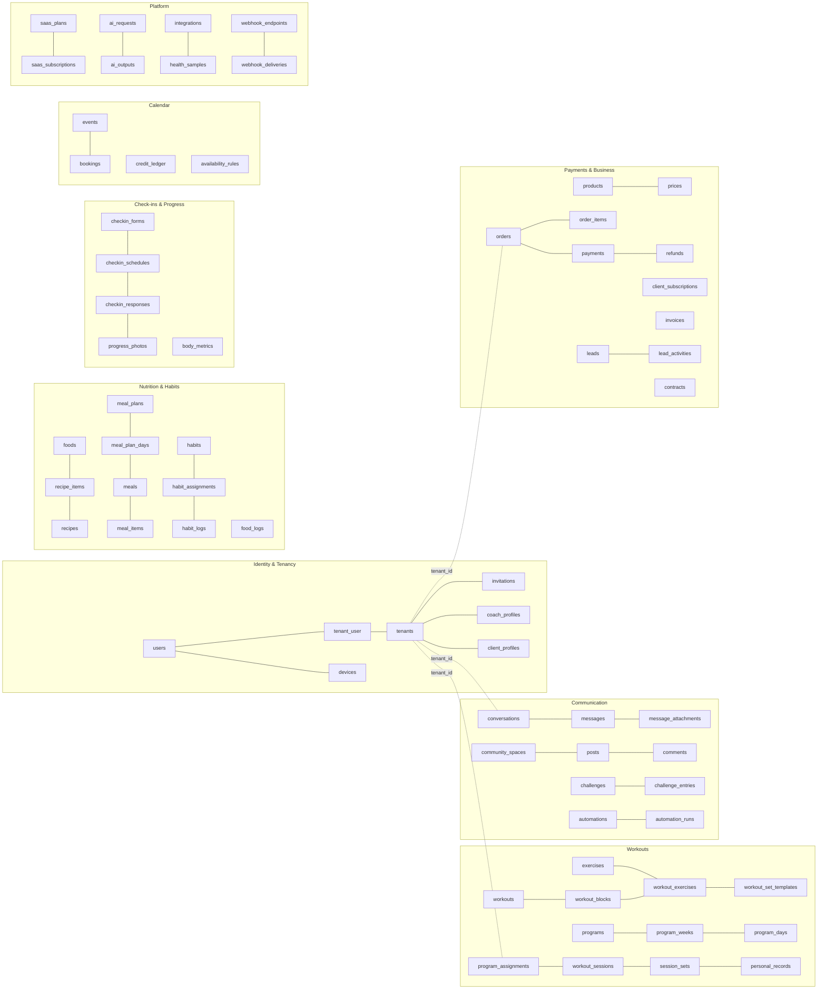
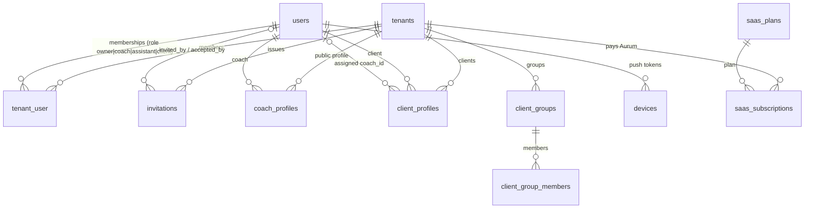
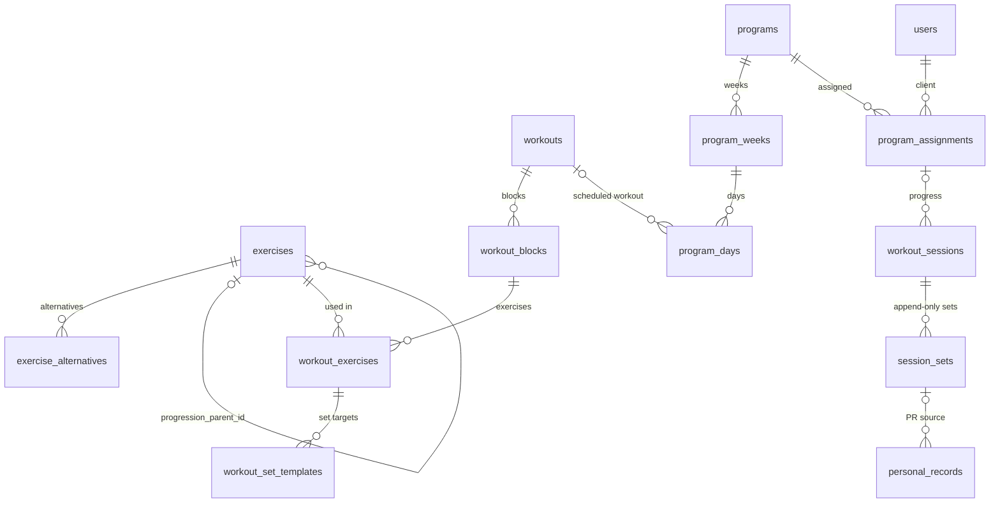
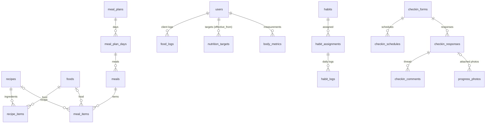
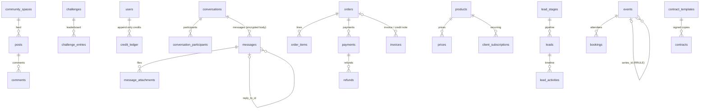

# Entity–Relationship Model

> **Generated from the real schema.** `node infra/scripts/generate-erd.mjs` (or `make erd`)
> parses every `up()` in `backend/database/migrations` in order, joins model metadata from
> `backend/app/Domain/*/Models` (tenant traits, encrypted casts) and rewrites
> [`erd.mmd`](erd.mmd), [`erd.json`](erd.json) and the table reference at the bottom of this
> file. Never edit those by hand — add a migration and regenerate.

## Conventions baked into the schema

| Rule | Implementation |
|---|---|
| Primary keys | **ULID strings on every domain table** (`$table->ulid('id')->primary()`, `HasUlids` via `BaseModel`). Offline-created rows (sessions, sets, food logs, water logs, messages) accept a client-generated ULID and are written with idempotent upserts. Framework tables (`jobs`, `failed_jobs`, `permissions`, `roles`) keep Laravel's bigint ids. See [ADR 0009](adr/0009-ulid-primary-keys.md). |
| Tenant scoping | Tenant-owned tables carry `tenant_id` (FK → `tenants`, cascade) and the model uses `BelongsToTenant` (global scope + auto-fill). Library tables (`exercises`, `foods`, `recipes`, `habits`, `workouts`, `programs`) use `SharedWithTenant`: `tenant_id NULL` = platform-global row visible to all, otherwise private to that tenant. Child tables without `tenant_id` are only reachable through their scoped parent ("via …" below). |
| Money | Integer minor units + ISO-4217 currency (`*_minor`, `currency`). Never floats. |
| Units | Metric only in storage: `*_kg`, `*_cm`, `*_m`, `ml`, `kcal`. |
| Time | UTC timestamps; `date` columns (`log_date`, `measured_on`, `due_on`) are the user's local calendar day. |
| Translatable content | JSON columns keyed by locale (`{"en": "...", "ar": "...", "fr": "...", "es": "..."}`) via `HasTranslations` — this replaces separate `*_translations` tables (`exercise_translations`, `food_translations`). |
| Soft deletes | Only where restoring matters (clients, content libraries, messages, events, leads, products, meal plans). |
| Encryption at rest | Laravel `encrypted` casts on special-category and secret columns (flagged **ENCRYPTED** below) on top of disk/volume encryption. |
| Data classification | Flags in the reference: **PII** personal data · **HEALTH** special-category health data (GDPR art. 9, PDPL "sensitive") · **SECRET** credentials/tokens. Drives export/erasure (`POST /me/export`, `DELETE /me`) and the store privacy labels in `store/privacy/`. |

## Domain map

The full diagram with every column and key is [`erd.mmd`](erd.mmd) (renders on GitHub; for
editors use the Mermaid Live Editor). It is large; the core relationships per domain follow.

### Identity & tenancy

### Workouts

### Nutrition, habits, check-ins

### Communication, calendar, payments

## Phase 0 entity checklist → physical tables

Every entity required by `docs/phases/phase-00-discovery-and-spec.md` and where it lives.

| Required entity | Physical table(s) | Notes |
|---|---|---|
| tenants, users, tenant_user (role) | `tenants`, `users`, `tenant_user` | role + status on pivot; spatie team roles mirror it (`roles.tenant_id`) |
| coach_profiles, client_profiles, invitations | same names | |
| teams | `tenant_user` (staff roles) + `client_groups` | a tenant *is* the team; groups organise clients |
| locations | `locations` | |
| exercises, exercise_translations, exercise_media | `exercises` | translations as JSON columns; media columns `video_*`, `poster_url`, `preview_url` |
| muscle_groups, equipment | same names | translatable `name` |
| workouts, workout_blocks, workout_exercises, workout_sets_template | `workouts`, `workout_blocks`, `workout_exercises`, `workout_set_templates` | |
| programs, program_weeks, program_days, assignments | same + `program_assignments` | |
| workout_sessions, session_sets, personal_records | same names | client ULIDs; `sync_mutations` records applied offline mutations |
| foods, food_translations | `foods` | translations + aliases JSON, `search_text` for accent-insensitive search |
| recipes, recipe_items | same names | |
| meal_plans, meal_plan_days, meals, meal_items | same names | |
| food_logs, water_logs, nutrition_targets | same names | |
| habits, habit_assignments, habit_logs | same names | |
| checkin_forms, checkin_questions | `checkin_forms.questions` (JSON) | questions are versioned with the form; answers keyed by question id |
| checkin_schedules, checkin_responses | same names (+ `checkin_comments`) | |
| body_metrics, progress_photos | same names | photos on private disk |
| conversations, conversation_participants, messages, message_attachments | same names (+ `message_reactions`) | |
| scheduled_messages, automations | same names (+ `automation_runs`, `message_templates`) | |
| community_spaces, posts, comments, reactions | same names (+ `content_reports`, `poll_votes`) | `reactions` is polymorphic |
| challenges, challenge_entries | same names (+ `user_badges`) | |
| calendars, availability_rules | `availability_rules`, `booking_settings` (per coach) | a "calendar" is a coach's rules + settings; `calendar_event_links` maps external calendar events |
| events, event_attendees, bookings, waitlists | `events`, `bookings` | attendees = bookings; waitlist = `bookings.status='waitlisted'` + `waitlist_position` |
| credit_ledgers | `credit_ledger` | append-only |
| products, packages, package_items, prices | `products` (`type=package…`), `products.fulfilment` (JSON), `prices` | package contents are fulfilment instructions |
| coupons, orders, order_items, payments, refunds, invoices | same names (+ `invoice_sequences`) | |
| payment_gateways | `payment_gateways` | credentials encrypted |
| payouts | — | coaches are merchant of record; payouts are made by each gateway. Commission payouts for Studio staff are exported from `commission_rules` + `analytics` (CSV) |
| client_subscriptions | same name | |
| saas_plans, saas_subscriptions (Cashier) | `saas_plans`, `saas_subscriptions`, `saas_invoices` | own billing service with a Stripe gateway driver (`App\Domain\Billing\Gateways`) rather than Cashier tables |
| usage_meters | same name | |
| leads, lead_stages | same names (+ `lead_activities`, `marketing_leads` for Aurum's own funnel) | |
| contracts, signatures | `contracts` (+ `contract_templates`) | signature data, IP, user agent, document hash on the contract row |
| ai_requests, ai_outputs, ai_settings | same names | |
| integrations, integration_tokens | `integrations` | tokens are encrypted columns on the integration row |
| health_samples | same name (+ `health_daily` aggregates) | dedupe on `external_id` |
| webhooks, webhook_deliveries | `webhook_endpoints`, `webhook_deliveries` (+ inbound `webhook_events`) | |
| notifications, devices | same names | |
| media (spatie) | — | paths stored on the owning row (`avatar_path`, `logo_path`, `progress_photos.path`, `message_attachments.path`); signed URLs generated per request |
| activity_log | `activity_logs` | includes `impersonator_id` |
| translations, feature_flags, settings | `translations`, `feature_flags`, `tenants.settings` (JSON) | |
| reviews (marketplace) | `reviews`, `review_requests` | verified clients only |
| analytics | `analytics_daily` | daily snapshots per tenant |
| blog / CMS | `blog_posts` | |

## Table reference (generated)

Scope legend: **tenant (global scope)** = `BelongsToTenant`; **shared library** = `SharedWithTenant`;
**tenant column (explicit where)** = has `tenant_id` but queried explicitly (platform, billing, AI metering);
**via X** = child table reached through its parent X; **user-owned** = keyed by `user_id` across tenants;
**global / system** = platform or framework table.

<!-- erd:tables:start -->

### `users`

- **Scope:** global / system · **Model:** `App\Domain\Identity\Models\User` · **Soft deletes**
- **Migration:** `0001_01_01_000000_create_users_table.php`
- **Indexes:** INDEX(phone) · INDEX(current_tenant_id)

| Column | Type | Null | Key / FK | Default | Flags | Notes |
|---|---|---|---|---|---|---|
| id | ulid |  | PK |  |  |  |
| name | string |  |  |  | PII |  |
| email | string |  | UK |  | PII |  |
| phone | string | yes |  |  | PII |  |
| email_verified_at | timestamp | yes |  |  |  |  |
| password | string | yes |  |  | PII (bcrypt hash) |  |
| avatar_path | string | yes |  |  | PII |  |
| locale | string |  |  | en |  |  |
| timezone | string |  |  | UTC |  |  |
| units | string |  |  | metric |  | metric imperial |
| theme | string |  |  | system |  |  |
| is_super_admin | boolean |  |  | false |  |  |
| current_tenant_id | ulid | yes |  |  |  |  |
| two_factor_secret | text | yes |  |  | ENCRYPTED, PII |  |
| two_factor_recovery_codes | text | yes |  |  | ENCRYPTED, PII |  |
| two_factor_confirmed_at | timestamp | yes |  |  |  |  |
| apple_id | string | yes | UK |  | PII |  |
| google_id | string | yes | UK |  | PII |  |
| notification_preferences | json | yes |  |  |  |  |
| quiet_hours | json | yes |  |  |  |  |
| last_login_at | timestamp | yes |  |  |  |  |
| last_active_at | timestamp | yes |  |  |  |  |
| failed_logins | smallint |  |  | 0 |  |  |
| locked_until | timestamp | yes |  |  |  |  |
| remember_token | string | yes |  |  | PII |  |
| created_at | timestamp | yes |  |  |  |  |
| updated_at | timestamp | yes |  |  |  |  |
| deleted_at | timestamp | yes |  |  |  |  |

### `password_reset_tokens`

- **Scope:** global / system
- **Migration:** `0001_01_01_000000_create_users_table.php`

| Column | Type | Null | Key / FK | Default | Flags | Notes |
|---|---|---|---|---|---|---|
| email | string |  | PK |  | PII |  |
| token | string |  |  |  |  |  |
| created_at | timestamp | yes |  |  |  |  |

### `sessions`

- **Scope:** user-owned
- **Migration:** `0001_01_01_000000_create_users_table.php`
- **Indexes:** INDEX(user_id) · INDEX(last_activity)

| Column | Type | Null | Key / FK | Default | Flags | Notes |
|---|---|---|---|---|---|---|
| id | string |  | PK |  |  |  |
| user_id | ulid | yes |  |  |  |  |
| ip_address | string | yes |  |  | PII |  |
| user_agent | text | yes |  |  | PII |  |
| payload | text |  |  |  | PII |  |
| last_activity | int |  |  |  |  |  |

### `tenants`

- **Scope:** global / system · **Model:** `App\Domain\Tenancy\Models\Tenant` · **Soft deletes**
- **Migration:** `0001_01_01_000000_create_users_table.php`

| Column | Type | Null | Key / FK | Default | Flags | Notes |
|---|---|---|---|---|---|---|
| id | ulid |  | PK |  |  |  |
| type | string |  |  | business |  | business personal |
| name | string |  |  |  |  |  |
| slug | string |  | UK |  |  |  |
| logo_path | string | yes |  |  |  |  |
| brand_color | string |  |  | #D4AF6A |  |  |
| currency | string |  |  | USD |  |  |
| country | string | yes |  |  |  |  |
| timezone | string |  |  | UTC |  |  |
| locale | string |  |  | en |  |  |
| plan | string |  |  | free |  |  |
| trial_ends_at | timestamp | yes |  |  |  |  |
| onboarded_at | timestamp | yes |  |  |  |  |
| settings | json | yes |  |  |  |  |
| legal | json | yes |  |  |  | legal name, VAT number, address for invoices |
| created_at | timestamp | yes |  |  |  |  |
| updated_at | timestamp | yes |  |  |  |  |
| deleted_at | timestamp | yes |  |  |  |  |

### `tenant_user`

- **Scope:** tenant (global scope) · **Model:** `App\Domain\Tenancy\Models\Membership`
- **Migration:** `0001_01_01_000000_create_users_table.php`
- **Indexes:** UNIQUE(tenant_id, user_id) · INDEX(tenant_id, role)

| Column | Type | Null | Key / FK | Default | Flags | Notes |
|---|---|---|---|---|---|---|
| id | ulid |  | PK |  |  |  |
| tenant_id | ulid |  | FK → tenants (cascade) |  |  |  |
| user_id | ulid |  | FK → users (cascade) |  |  |  |
| role | string |  |  |  |  | owner coach assistant client |
| status | string |  |  | active |  | active invited archived |
| joined_at | timestamp | yes |  |  |  |  |
| created_at | timestamp | yes |  |  |  |  |
| updated_at | timestamp | yes |  |  |  |  |

### `invitations`

- **Scope:** tenant (global scope) · **Model:** `App\Domain\Tenancy\Models\Invitation`
- **Migration:** `0001_01_01_000000_create_users_table.php`
- **Indexes:** INDEX(tenant_id, email)

| Column | Type | Null | Key / FK | Default | Flags | Notes |
|---|---|---|---|---|---|---|
| id | ulid |  | PK |  |  |  |
| tenant_id | ulid |  | FK → tenants (cascade) |  |  |  |
| invited_by | ulid | yes | FK → users (set null) |  |  |  |
| code | string |  | UK |  |  |  |
| email | string | yes |  |  | PII |  |
| phone | string | yes |  |  | PII |  |
| name | string | yes |  |  | PII |  |
| role | string |  |  | client |  |  |
| payload | json | yes |  |  |  | program to assign, tags... |
| expires_at | timestamp | yes |  |  |  |  |
| accepted_at | timestamp | yes |  |  |  |  |
| accepted_by | ulid | yes | FK → users (set null) |  |  |  |
| created_at | timestamp | yes |  |  |  |  |
| updated_at | timestamp | yes |  |  |  |  |

### `devices`

- **Scope:** user-owned · **Model:** `App\Domain\Identity\Models\Device`
- **Migration:** `0001_01_01_000000_create_users_table.php`
- **Indexes:** UNIQUE(user_id, push_token)

| Column | Type | Null | Key / FK | Default | Flags | Notes |
|---|---|---|---|---|---|---|
| id | ulid |  | PK |  |  |  |
| user_id | ulid |  | FK → users (cascade) |  |  |  |
| name | string | yes |  |  | PII |  |
| platform | string |  |  |  |  | ios android web |
| push_token | string | yes |  |  | PII |  |
| app | string |  |  | client |  | client coach |
| app_version | string | yes |  |  |  |  |
| locale | string | yes |  |  |  |  |
| timezone | string | yes |  |  |  |  |
| last_seen_at | timestamp | yes |  |  |  |  |
| created_at | timestamp | yes |  |  |  |  |
| updated_at | timestamp | yes |  |  |  |  |

### `magic_links`

- **Scope:** global / system · **Model:** `App\Domain\Identity\Models\MagicLink`
- **Migration:** `0001_01_01_000000_create_users_table.php`
- **Indexes:** INDEX(email)

| Column | Type | Null | Key / FK | Default | Flags | Notes |
|---|---|---|---|---|---|---|
| id | ulid |  | PK |  |  |  |
| email | string |  |  |  | PII |  |
| token_hash | string |  | UK |  |  |  |
| expires_at | timestamp |  |  |  |  |  |
| used_at | timestamp | yes |  |  |  |  |
| created_at | timestamp | yes |  |  |  |  |
| updated_at | timestamp | yes |  |  |  |  |

### `activity_logs`

- **Scope:** tenant column (explicit where) · **Model:** `App\Domain\Identity\Models\ActivityLog`
- **Migration:** `0001_01_01_000000_create_users_table.php`
- **Indexes:** INDEX(tenant_id) · INDEX(causer_id) · INDEX(event) · INDEX(subject_type, subject_id) · INDEX(created_at)

| Column | Type | Null | Key / FK | Default | Flags | Notes |
|---|---|---|---|---|---|---|
| id | ulid |  | PK |  |  |  |
| tenant_id | ulid | yes |  |  |  |  |
| causer_id | ulid | yes |  |  |  |  |
| impersonator_id | ulid | yes |  |  |  |  |
| event | string |  |  |  |  |  |
| subject_type | string | yes |  |  |  | polymorphic |
| subject_id | ulid | yes |  |  |  | polymorphic |
| properties | json | yes |  |  |  |  |
| ip | string | yes |  |  | PII |  |
| user_agent | string | yes |  |  | PII |  |
| created_at | timestamp |  |  |  |  |  |

### `feature_flags`

- **Scope:** global / system · **Model:** `App\Domain\Tenancy\Models\FeatureFlag`
- **Migration:** `0001_01_01_000000_create_users_table.php`

| Column | Type | Null | Key / FK | Default | Flags | Notes |
|---|---|---|---|---|---|---|
| id | ulid |  | PK |  |  |  |
| key | string |  | UK |  |  |  |
| description | string | yes |  |  |  |  |
| enabled | boolean |  |  | false |  |  |
| plans | json | yes |  |  |  | restrict to plans |
| tenants | json | yes |  |  |  | allow-list tenant ids |
| rollout | tinyint |  |  | 100 |  |  |
| created_at | timestamp | yes |  |  |  |  |
| updated_at | timestamp | yes |  |  |  |  |

### `translations`

- **Scope:** global / system · **Model:** `App\Domain\Tenancy\Models\Translation`
- **Migration:** `0001_01_01_000000_create_users_table.php`
- **Indexes:** UNIQUE(locale, group, key)

| Column | Type | Null | Key / FK | Default | Flags | Notes |
|---|---|---|---|---|---|---|
| id | ulid |  | PK |  |  |  |
| locale | string |  |  |  |  |  |
| group | string |  |  | * |  |  |
| key | string |  |  |  |  |  |
| value | text |  |  |  |  |  |
| created_at | timestamp | yes |  |  |  |  |
| updated_at | timestamp | yes |  |  |  |  |

### `coach_profiles`

- **Scope:** tenant (global scope) · **Model:** `App\Domain\Tenancy\Models\CoachProfile`
- **Migration:** `0001_01_01_000000_create_users_table.php`
- **Indexes:** INDEX(is_published, city)

| Column | Type | Null | Key / FK | Default | Flags | Notes |
|---|---|---|---|---|---|---|
| id | ulid |  | PK |  |  |  |
| tenant_id | ulid |  | FK → tenants (cascade) |  |  |  |
| user_id | ulid |  | FK → users (cascade) |  |  |  |
| slug | string |  | UK |  |  |  |
| headline | string | yes |  |  | PII (public) |  |
| bio | json | yes |  |  | PII (public) | translatable |
| specialties | json | yes |  |  |  |  |
| languages | json | yes |  |  |  |  |
| certifications | json | yes |  |  |  |  |
| city | string | yes |  |  |  |  |
| country | string | yes |  |  |  |  |
| gender | string | yes |  |  | PII (public) |  |
| offers_online | boolean |  |  | true |  |  |
| offers_in_person | boolean |  |  | false |  |  |
| price_from_minor | int | yes |  |  |  |  |
| instagram | string | yes |  |  | PII (public) |  |
| intro_video_url | string | yes |  |  | PII (public) |  |
| is_published | boolean |  |  | false |  |  |
| is_verified | boolean |  |  | false |  |  |
| is_featured | boolean |  |  | false |  |  |
| rating_avg | decimal |  |  | 0 |  |  |
| rating_count | int |  |  | 0 |  |  |
| created_at | timestamp | yes |  |  |  |  |
| updated_at | timestamp | yes |  |  |  |  |

### `client_profiles`

- **Scope:** tenant (global scope) · **Model:** `App\Domain\Tenancy\Models\ClientProfile` · **Soft deletes**
- **Migration:** `0001_01_01_000000_create_users_table.php`
- **Indexes:** UNIQUE(tenant_id, user_id) · INDEX(tenant_id, coach_id, status)

| Column | Type | Null | Key / FK | Default | Flags | Notes |
|---|---|---|---|---|---|---|
| id | ulid |  | PK |  |  |  |
| tenant_id | ulid |  | FK → tenants (cascade) |  |  |  |
| user_id | ulid |  | FK → users (cascade) |  |  |  |
| coach_id | ulid | yes | FK → users (set null) |  |  |  |
| status | string |  |  | active |  | lead active paused archived |
| goal | string | yes |  |  |  | fat_loss muscle_gain strength performance health |
| level | string | yes |  |  |  | beginner intermediate advanced |
| date_of_birth | text | yes |  |  | ENCRYPTED, PII | encrypted |
| gender | string | yes |  |  | HEALTH |  |
| height_cm | decimal | yes |  |  | HEALTH |  |
| activity_level | string | yes |  |  |  |  |
| injuries | text | yes |  |  | ENCRYPTED, HEALTH | encrypted |
| medical_notes | text | yes |  |  | ENCRYPTED, HEALTH | encrypted |
| equipment | json | yes |  |  |  |  |
| days_per_week | tinyint | yes |  |  |  |  |
| diet_tags | json | yes |  |  |  |  |
| tags | json | yes |  |  |  |  |
| onboarding | json | yes |  |  | HEALTH |  |
| parq_flagged | boolean |  |  | false | HEALTH |  |
| compliance_score | tinyint | yes |  |  |  |  |
| risk_status | string |  |  | green |  | green amber red |
| last_active_at | timestamp | yes |  |  |  |  |
| created_at | timestamp | yes |  |  |  |  |
| updated_at | timestamp | yes |  |  |  |  |
| deleted_at | timestamp | yes |  |  |  |  |

### `client_groups`

- **Scope:** tenant (global scope) · **Model:** `App\Domain\Tenancy\Models\ClientGroup`
- **Migration:** `0001_01_01_000000_create_users_table.php`

| Column | Type | Null | Key / FK | Default | Flags | Notes |
|---|---|---|---|---|---|---|
| id | ulid |  | PK |  |  |  |
| tenant_id | ulid |  | FK → tenants (cascade) |  |  |  |
| name | string |  |  |  |  |  |
| color | string | yes |  |  |  |  |
| created_at | timestamp | yes |  |  |  |  |
| updated_at | timestamp | yes |  |  |  |  |

### `client_group_members`

- **Scope:** via client_groups
- **Migration:** `0001_01_01_000000_create_users_table.php`
- **Indexes:** PRIMARY(client_group_id, user_id)

| Column | Type | Null | Key / FK | Default | Flags | Notes |
|---|---|---|---|---|---|---|
| client_group_id | ulid |  | PK FK → client_groups (cascade) |  |  |  |
| user_id | ulid |  | PK FK → users (cascade) |  |  |  |

### `cache`

- **Scope:** global / system
- **Migration:** `0001_01_01_000001_create_cache_table.php`
- **Indexes:** INDEX(expiration)

| Column | Type | Null | Key / FK | Default | Flags | Notes |
|---|---|---|---|---|---|---|
| key | string |  | PK |  |  |  |
| value | text |  |  |  |  |  |
| expiration | bigint |  |  |  |  |  |

### `cache_locks`

- **Scope:** global / system
- **Migration:** `0001_01_01_000001_create_cache_table.php`
- **Indexes:** INDEX(expiration)

| Column | Type | Null | Key / FK | Default | Flags | Notes |
|---|---|---|---|---|---|---|
| key | string |  | PK |  |  |  |
| owner | string |  |  |  |  |  |
| expiration | bigint |  |  |  |  |  |

### `jobs`

- **Scope:** global / system
- **Migration:** `0001_01_01_000002_create_jobs_table.php`
- **Indexes:** INDEX(queue)

| Column | Type | Null | Key / FK | Default | Flags | Notes |
|---|---|---|---|---|---|---|
| id | bigint |  | PK |  |  |  |
| queue | string |  |  |  |  |  |
| payload | text |  |  |  |  |  |
| attempts | smallint |  |  |  |  |  |
| reserved_at | int | yes |  |  |  |  |
| available_at | int |  |  |  |  |  |
| created_at | int |  |  |  |  |  |

### `job_batches`

- **Scope:** global / system
- **Migration:** `0001_01_01_000002_create_jobs_table.php`

| Column | Type | Null | Key / FK | Default | Flags | Notes |
|---|---|---|---|---|---|---|
| id | string |  | PK |  |  |  |
| name | string |  |  |  |  |  |
| total_jobs | int |  |  |  |  |  |
| pending_jobs | int |  |  |  |  |  |
| failed_jobs | int |  |  |  |  |  |
| failed_job_ids | text |  |  |  |  |  |
| options | text | yes |  |  |  |  |
| cancelled_at | int | yes |  |  |  |  |
| created_at | int |  |  |  |  |  |
| finished_at | int | yes |  |  |  |  |

### `failed_jobs`

- **Scope:** global / system
- **Migration:** `0001_01_01_000002_create_jobs_table.php`
- **Indexes:** INDEX(connection, queue, failed_at)

| Column | Type | Null | Key / FK | Default | Flags | Notes |
|---|---|---|---|---|---|---|
| id | bigint |  | PK |  |  |  |
| uuid | string |  | UK |  |  |  |
| connection | string |  |  |  |  |  |
| queue | string |  |  |  |  |  |
| payload | text |  |  |  |  |  |
| exception | text |  |  |  |  |  |
| failed_at | timestamp |  |  |  |  |  |

### `permissions`

- **Scope:** global / system
- **Migration:** `0001_01_01_000010_create_permission_tables.php`
- **Indexes:** UNIQUE(name, guard_name)

| Column | Type | Null | Key / FK | Default | Flags | Notes |
|---|---|---|---|---|---|---|
| id | bigint |  | PK |  |  | permission id |
| name | string |  |  |  |  |  |
| guard_name | string |  |  |  |  |  |
| created_at | timestamp | yes |  |  |  |  |
| updated_at | timestamp | yes |  |  |  |  |

### `roles`

- **Scope:** tenant column (explicit where)
- **Migration:** `0001_01_01_000010_create_permission_tables.php`
- **Indexes:** UNIQUE(tenant_id, name, guard_name) · UNIQUE(name, guard_name) · INDEX(tenant_id)

| Column | Type | Null | Key / FK | Default | Flags | Notes |
|---|---|---|---|---|---|---|
| id | bigint |  | PK |  |  | role id |
| tenant_id | string | yes |  |  |  |  |
| name | string |  |  |  |  |  |
| guard_name | string |  |  |  |  |  |
| created_at | timestamp | yes |  |  |  |  |
| updated_at | timestamp | yes |  |  |  |  |

### `model_has_permissions`

- **Scope:** tenant column (explicit where)
- **Migration:** `0001_01_01_000010_create_permission_tables.php`
- **Indexes:** PRIMARY(permission_id, model_id, model_type) · INDEX(model_id, model_type) · INDEX(tenant_id)

| Column | Type | Null | Key / FK | Default | Flags | Notes |
|---|---|---|---|---|---|---|
| permission_id | bigint |  | PK FK → permissions |  |  |  |
| model_type | string |  | PK |  |  |  |
| model_id | string |  | PK |  |  |  |
| tenant_id | string |  |  |  |  |  |

### `model_has_roles`

- **Scope:** tenant column (explicit where)
- **Migration:** `0001_01_01_000010_create_permission_tables.php`
- **Indexes:** PRIMARY(role_id, model_id, model_type) · INDEX(model_id, model_type) · INDEX(tenant_id)

| Column | Type | Null | Key / FK | Default | Flags | Notes |
|---|---|---|---|---|---|---|
| role_id | bigint |  | PK FK → roles |  |  |  |
| model_type | string |  | PK |  |  |  |
| model_id | string |  | PK |  |  |  |
| tenant_id | string |  |  |  |  |  |

### `role_has_permissions`

- **Scope:** via permissions
- **Migration:** `0001_01_01_000010_create_permission_tables.php`
- **Indexes:** PRIMARY(permission_id, role_id)

| Column | Type | Null | Key / FK | Default | Flags | Notes |
|---|---|---|---|---|---|---|
| permission_id | bigint |  | PK FK → permissions |  |  |  |
| role_id | bigint |  | PK FK → roles |  |  |  |

### `personal_access_tokens`

- **Scope:** global / system
- **Migration:** `0001_01_01_000011_create_personal_access_tokens_table.php`
- **Indexes:** INDEX(tokenable_type, tokenable_id) · INDEX(expires_at)

| Column | Type | Null | Key / FK | Default | Flags | Notes |
|---|---|---|---|---|---|---|
| id | bigint |  | PK |  |  |  |
| tokenable_type | string |  |  |  |  | polymorphic |
| tokenable_id | ulid |  |  |  |  | polymorphic |
| name | text |  |  |  |  |  |
| token | string |  | UK |  | SECRET (sha256) |  |
| abilities | text | yes |  |  |  |  |
| last_used_at | timestamp | yes |  |  |  |  |
| expires_at | timestamp | yes |  |  |  |  |
| created_at | timestamp | yes |  |  |  |  |
| updated_at | timestamp | yes |  |  |  |  |

### `muscle_groups`

- **Scope:** global / system · **Model:** `App\Domain\Workouts\Models\MuscleGroup`
- **Migration:** `2026_01_01_000100_create_workout_tables.php`

| Column | Type | Null | Key / FK | Default | Flags | Notes |
|---|---|---|---|---|---|---|
| id | ulid |  | PK |  |  |  |
| key | string |  | UK |  |  |  |
| name | json |  |  |  |  |  |
| region | string |  |  |  |  | upper lower core full |

### `equipment`

- **Scope:** global / system · **Model:** `App\Domain\Workouts\Models\Equipment`
- **Migration:** `2026_01_01_000100_create_workout_tables.php`

| Column | Type | Null | Key / FK | Default | Flags | Notes |
|---|---|---|---|---|---|---|
| id | ulid |  | PK |  |  |  |
| key | string |  | UK |  |  |  |
| name | json |  |  |  |  |  |

### `exercises`

- **Scope:** shared library (tenant_id NULL = global) · **Model:** `App\Domain\Workouts\Models\Exercise` · **Soft deletes**
- **Migration:** `2026_01_01_000100_create_workout_tables.php`
- **Indexes:** UNIQUE(tenant_id, slug) · INDEX(slug) · INDEX(primary_muscle)

| Column | Type | Null | Key / FK | Default | Flags | Notes |
|---|---|---|---|---|---|---|
| id | ulid |  | PK |  |  |  |
| tenant_id | ulid | yes | FK → tenants (cascade) |  |  | null = global library |
| slug | string |  |  |  |  |  |
| name | json |  |  |  |  |  |
| instructions | json | yes |  |  |  |  locale: [steps]  |
| tips | json | yes |  |  |  |  |
| mistakes | json | yes |  |  |  |  |
| aliases | json | yes |  |  |  | search synonyms per locale |
| primary_muscle | string | yes |  |  |  |  |
| secondary_muscles | json | yes |  |  |  |  |
| equipment | json | yes |  |  |  |  |
| pattern | string | yes |  |  |  | squat hinge push_h push_v pull_h pull_v lunge carry rotation core cardio mobility |
| mechanics | string | yes |  |  |  | compound isolation |
| force | string | yes |  |  |  | push pull static |
| level | string |  |  | beginner |  |  |
| is_unilateral | boolean |  |  | false |  |  |
| is_bodyweight | boolean |  |  | false |  |  |
| metrics | json | yes |  |  |  | ['weight','reps'] |
| progression_parent_id | ulid | yes | FK → exercises (set null) |  |  |  |
| progression_step | tinyint | yes |  |  |  |  |
| video_provider | string | yes |  |  |  | hls youtube vimeo upload |
| video_url | string | yes |  |  |  |  |
| video_status | string | yes |  |  |  | pending processing ready failed |
| poster_url | string | yes |  |  |  |  |
| preview_url | string | yes |  |  |  |  |
| is_published | boolean |  |  | true |  |  |
| created_at | timestamp | yes |  |  |  |  |
| updated_at | timestamp | yes |  |  |  |  |
| deleted_at | timestamp | yes |  |  |  |  |
| search_text | text | yes |  |  |  |  |
| video_path | string | yes |  |  |  |  |
| video_size_bytes | bigint | yes |  |  |  |  |

### `exercise_alternatives`

- **Scope:** via exercises
- **Migration:** `2026_01_01_000100_create_workout_tables.php`
- **Indexes:** PRIMARY(exercise_id, alternative_id)

| Column | Type | Null | Key / FK | Default | Flags | Notes |
|---|---|---|---|---|---|---|
| exercise_id | ulid |  | PK FK → exercises (cascade) |  |  |  |
| alternative_id | ulid |  | PK FK → exercises (cascade) |  |  |  |

### `exercise_favorites`

- **Scope:** via exercises
- **Migration:** `2026_01_01_000100_create_workout_tables.php`
- **Indexes:** PRIMARY(user_id, exercise_id)

| Column | Type | Null | Key / FK | Default | Flags | Notes |
|---|---|---|---|---|---|---|
| user_id | ulid |  | PK FK → users (cascade) |  |  |  |
| exercise_id | ulid |  | PK FK → exercises (cascade) |  |  |  |

### `workouts`

- **Scope:** shared library (tenant_id NULL = global) · **Model:** `App\Domain\Workouts\Models\Workout` · **Soft deletes**
- **Migration:** `2026_01_01_000100_create_workout_tables.php`

| Column | Type | Null | Key / FK | Default | Flags | Notes |
|---|---|---|---|---|---|---|
| id | ulid |  | PK |  |  |  |
| tenant_id | ulid | yes | FK → tenants (cascade) |  |  |  |
| created_by | ulid | yes | FK → users (set null) |  |  |  |
| name | string |  |  |  |  |  |
| description | text | yes |  |  |  |  |
| tags | json | yes |  |  |  |  |
| difficulty | string |  |  | intermediate |  |  |
| estimated_minutes | smallint |  |  | 0 |  |  |
| equipment_summary | json | yes |  |  |  |  |
| is_template | boolean |  |  | false |  |  |
| version | int |  |  | 1 |  |  |
| source_id | ulid | yes | FK → workouts (set null) |  |  |  |
| created_at | timestamp | yes |  |  |  |  |
| updated_at | timestamp | yes |  |  |  |  |
| deleted_at | timestamp | yes |  |  |  |  |

### `workout_blocks`

- **Scope:** via workouts · **Model:** `App\Domain\Workouts\Models\WorkoutBlock`
- **Migration:** `2026_01_01_000100_create_workout_tables.php`
- **Indexes:** INDEX(workout_id, position)

| Column | Type | Null | Key / FK | Default | Flags | Notes |
|---|---|---|---|---|---|---|
| id | ulid |  | PK |  |  |  |
| workout_id | ulid |  | FK → workouts (cascade) |  |  |  |
| position | smallint |  |  |  |  |  |
| type | string |  |  | straight |  | straight superset giant circuit tabata emom amrap interval warmup cooldown |
| name | string | yes |  |  |  |  |
| rounds | smallint |  |  | 1 |  |  |
| work_seconds | smallint | yes |  |  |  |  |
| rest_seconds | smallint | yes |  |  |  |  |
| rest_between_rounds | smallint | yes |  |  |  |  |
| time_cap_seconds | smallint | yes |  |  |  |  |
| notes | text | yes |  |  |  |  |

### `workout_exercises`

- **Scope:** via workout_blocks · **Model:** `App\Domain\Workouts\Models\WorkoutExercise`
- **Migration:** `2026_01_01_000100_create_workout_tables.php`
- **Indexes:** INDEX(workout_block_id, position)

| Column | Type | Null | Key / FK | Default | Flags | Notes |
|---|---|---|---|---|---|---|
| id | ulid |  | PK |  |  |  |
| workout_block_id | ulid |  | FK → workout_blocks (cascade) |  |  |  |
| exercise_id | ulid |  | FK → exercises |  |  |  |
| position | smallint |  |  |  |  |  |
| rest_seconds | smallint | yes |  |  |  |  |
| tempo | string | yes |  |  |  |  |
| notes | text | yes |  |  |  |  |
| alternative_ids | json | yes |  |  |  |  |
| progression_rule | json | yes |  |  |  |  type: linear_load percent_week rep_progression, ...  |

### `workout_set_templates`

- **Scope:** via workout_exercises · **Model:** `App\Domain\Workouts\Models\WorkoutSetTemplate`
- **Migration:** `2026_01_01_000100_create_workout_tables.php`
- **Indexes:** INDEX(workout_exercise_id, position)

| Column | Type | Null | Key / FK | Default | Flags | Notes |
|---|---|---|---|---|---|---|
| id | ulid |  | PK |  |  |  |
| workout_exercise_id | ulid |  | FK → workout_exercises (cascade) |  |  |  |
| position | smallint |  |  |  |  |  |
| set_type | string |  |  | working |  | warmup working drop failure amrap |
| reps_min | smallint | yes |  |  |  |  |
| reps_max | smallint | yes |  |  |  |  |
| weight_kg | decimal | yes |  |  |  |  |
| percent_1rm | decimal | yes |  |  |  |  |
| rpe | decimal | yes |  |  |  |  |
| rir | tinyint | yes |  |  |  |  |
| duration_seconds | smallint | yes |  |  |  |  |
| distance_m | int | yes |  |  |  |  |
| rest_seconds | smallint | yes |  |  |  |  |

### `programs`

- **Scope:** shared library (tenant_id NULL = global) · **Model:** `App\Domain\Workouts\Models\Program` · **Soft deletes**
- **Migration:** `2026_01_01_000100_create_workout_tables.php`
- **Indexes:** INDEX(slug)

| Column | Type | Null | Key / FK | Default | Flags | Notes |
|---|---|---|---|---|---|---|
| id | ulid |  | PK |  |  |  |
| tenant_id | ulid | yes | FK → tenants (cascade) |  |  |  |
| created_by | ulid | yes | FK → users (set null) |  |  |  |
| slug | string | yes |  |  |  |  |
| name | json |  |  |  |  |  |
| description | json | yes |  |  |  |  |
| goal | string | yes |  |  |  |  |
| level | string |  |  | intermediate |  |  |
| days_per_week | tinyint |  |  | 3 |  |  |
| equipment | json | yes |  |  |  |  |
| tags | json | yes |  |  |  |  |
| visibility | string |  |  | private |  | private tenant_template public |
| is_template | boolean |  |  | false |  |  |
| cover_url | string | yes |  |  |  |  |
| created_at | timestamp | yes |  |  |  |  |
| updated_at | timestamp | yes |  |  |  |  |
| deleted_at | timestamp | yes |  |  |  |  |

### `program_weeks`

- **Scope:** via programs · **Model:** `App\Domain\Workouts\Models\ProgramWeek`
- **Migration:** `2026_01_01_000100_create_workout_tables.php`
- **Indexes:** UNIQUE(program_id, number)

| Column | Type | Null | Key / FK | Default | Flags | Notes |
|---|---|---|---|---|---|---|
| id | ulid |  | PK |  |  |  |
| program_id | ulid |  | FK → programs (cascade) |  |  |  |
| number | smallint |  |  |  |  |  |
| phase | string | yes |  |  |  | hypertrophy strength peak deload |
| is_deload | boolean |  |  | false |  |  |
| notes | text | yes |  |  |  |  |

### `program_days`

- **Scope:** via program_weeks · **Model:** `App\Domain\Workouts\Models\ProgramDay`
- **Migration:** `2026_01_01_000100_create_workout_tables.php`
- **Indexes:** INDEX(program_week_id, day_number)

| Column | Type | Null | Key / FK | Default | Flags | Notes |
|---|---|---|---|---|---|---|
| id | ulid |  | PK |  |  |  |
| program_week_id | ulid |  | FK → program_weeks (cascade) |  |  |  |
| day_number | tinyint |  |  |  |  | 1..7 |
| workout_id | ulid | yes | FK → workouts (set null) |  |  |  |
| meal_plan_id | ulid | yes |  |  |  |  |
| habit_ids | json | yes |  |  |  |  |
| title | string | yes |  |  |  |  |
| is_rest | boolean |  |  | false |  |  |

### `program_assignments`

- **Scope:** tenant (global scope) · **Model:** `App\Domain\Workouts\Models\ProgramAssignment`
- **Migration:** `2026_01_01_000100_create_workout_tables.php`
- **Indexes:** INDEX(tenant_id, client_id, status)

| Column | Type | Null | Key / FK | Default | Flags | Notes |
|---|---|---|---|---|---|---|
| id | ulid |  | PK |  |  |  |
| tenant_id | ulid |  | FK → tenants (cascade) |  |  |  |
| program_id | ulid |  | FK → programs (cascade) |  |  |  |
| client_id | ulid |  | FK → users (cascade) |  |  |  |
| assigned_by | ulid | yes | FK → users (set null) |  |  |  |
| start_date | date |  |  |  |  |  |
| status | string |  |  | active |  | scheduled active paused completed cancelled |
| unlock_mode | string |  |  | all |  | all weekly_drip daily |
| paused_at | date | yes |  |  |  |  |
| shift_days | smallint |  |  | 0 |  |  |
| created_at | timestamp | yes |  |  |  |  |
| updated_at | timestamp | yes |  |  |  |  |

### `workout_sessions`

- **Scope:** tenant (global scope) · **Model:** `App\Domain\Workouts\Models\WorkoutSession` · **Soft deletes**
- **Migration:** `2026_01_01_000100_create_workout_tables.php`
- **Indexes:** INDEX(tenant_id, client_id, started_at) · INDEX(client_id, updated_at)

| Column | Type | Null | Key / FK | Default | Flags | Notes |
|---|---|---|---|---|---|---|
| id | ulid |  | PK |  |  | client-generated ULID allowed |
| tenant_id | ulid |  | FK → tenants (cascade) |  |  |  |
| client_id | ulid |  | FK → users (cascade) |  |  |  |
| workout_id | ulid | yes | FK → workouts (set null) |  |  |  |
| program_assignment_id | ulid | yes | FK → program_assignments (set null) |  |  |  |
| program_day_id | ulid | yes | FK → program_days (set null) |  |  |  |
| name | string | yes |  |  |  |  |
| status | string |  |  | in_progress |  | in_progress completed abandoned |
| started_at | timestamp |  |  |  |  |  |
| ended_at | timestamp | yes |  |  |  |  |
| duration_seconds | int | yes |  |  |  |  |
| total_volume_kg | decimal |  |  | 0 |  |  |
| perceived_effort | tinyint | yes |  |  | HEALTH |  |
| mood | string | yes |  |  | HEALTH |  |
| notes | text | yes |  |  | HEALTH |  |
| created_at | timestamp | yes |  |  |  |  |
| updated_at | timestamp | yes |  |  |  |  |
| deleted_at | timestamp | yes |  |  |  |  |

### `session_sets`

- **Scope:** via workout_sessions · **Model:** `App\Domain\Workouts\Models\SessionSet` · **Soft deletes**
- **Migration:** `2026_01_01_000100_create_workout_tables.php`
- **Indexes:** INDEX(exercise_id, completed_at) · INDEX(workout_session_id, updated_at)

| Column | Type | Null | Key / FK | Default | Flags | Notes |
|---|---|---|---|---|---|---|
| id | ulid |  | PK |  |  | client mutation ULID — idempotent sync |
| workout_session_id | ulid |  | FK → workout_sessions (cascade) |  |  |  |
| exercise_id | ulid |  | FK → exercises |  |  |  |
| workout_exercise_id | ulid | yes |  |  |  |  |
| set_number | smallint |  |  |  |  |  |
| set_type | string |  |  | working |  |  |
| reps | smallint | yes |  |  | HEALTH |  |
| weight_kg | decimal | yes |  |  | HEALTH |  |
| duration_seconds | smallint | yes |  |  |  |  |
| distance_m | int | yes |  |  |  |  |
| rpe | decimal | yes |  |  | HEALTH |  |
| is_completed | boolean |  |  | true |  |  |
| completed_at | timestamp | yes |  |  |  |  |
| created_at | timestamp | yes |  |  |  |  |
| updated_at | timestamp | yes |  |  |  |  |
| deleted_at | timestamp | yes |  |  |  |  |

### `personal_records`

- **Scope:** tenant (global scope) · **Model:** `App\Domain\Workouts\Models\PersonalRecord`
- **Migration:** `2026_01_01_000100_create_workout_tables.php`
- **Indexes:** INDEX(client_id, exercise_id, type)

| Column | Type | Null | Key / FK | Default | Flags | Notes |
|---|---|---|---|---|---|---|
| id | ulid |  | PK |  |  |  |
| tenant_id | ulid |  | FK → tenants (cascade) |  |  |  |
| client_id | ulid |  | FK → users (cascade) |  |  |  |
| exercise_id | ulid |  | FK → exercises (cascade) |  |  |  |
| session_set_id | ulid | yes | FK → session_sets (set null) |  |  |  |
| type | string |  |  |  |  | e1rm weight reps volume |
| value | decimal |  |  |  | HEALTH |  |
| previous_value | decimal | yes |  |  |  |  |
| achieved_at | timestamp |  |  |  |  |  |
| created_at | timestamp | yes |  |  |  |  |
| updated_at | timestamp | yes |  |  |  |  |
| workout_session_id | ulid | yes | FK → workout_sessions (cascade) |  |  |  |
| weight_kg | decimal | yes |  |  |  |  |

### `foods`

- **Scope:** shared library (tenant_id NULL = global) · **Model:** `App\Domain\Nutrition\Models\Food` · **Soft deletes**
- **Migration:** `2026_01_01_000200_create_nutrition_habit_checkin_tables.php`
- **Indexes:** INDEX(barcode)

| Column | Type | Null | Key / FK | Default | Flags | Notes |
|---|---|---|---|---|---|---|
| id | ulid |  | PK |  |  |  |
| tenant_id | ulid | yes | FK → tenants (cascade) |  |  |  |
| name | json |  |  |  |  |  |
| aliases | json | yes |  |  |  |  |
| brand | string | yes |  |  |  |  |
| barcode | string | yes |  |  |  |  |
| source | string |  |  | custom |  | usda off regional custom user |
| region | string | yes |  |  |  | gulf levant maghreb french international |
| category | string | yes |  |  |  | aisle: produce meat dairy bakery grains pantry drinks frozen snacks prepared |
| kcal | decimal |  |  |  |  |  |
| protein_g | decimal |  |  | 0 |  |  |
| carbs_g | decimal |  |  | 0 |  |  |
| fat_g | decimal |  |  | 0 |  |  |
| fiber_g | decimal |  |  | 0 |  |  |
| sugar_g | decimal |  |  | 0 |  |  |
| sodium_mg | decimal |  |  | 0 |  |  |
| micros | json | yes |  |  |  |  |
| servings | json | yes |  |  |  | [ unit:'cup', grams:240, label: en:..  ] |
| diet_tags | json | yes |  |  |  | halal vegan vegetarian gluten_free dairy_free keto |
| allergens | json | yes |  |  |  |  |
| is_verified | boolean |  |  | false |  |  |
| moderation | string |  |  | approved |  | pending approved rejected |
| submitted_by | ulid | yes | FK → users (set null) |  |  |  |
| created_at | timestamp | yes |  |  |  |  |
| updated_at | timestamp | yes |  |  |  |  |
| deleted_at | timestamp | yes |  |  |  |  |
| search_text | text | yes |  |  |  |  |

### `recipes`

- **Scope:** shared library (tenant_id NULL = global) · **Model:** `App\Domain\Nutrition\Models\Recipe` · **Soft deletes**
- **Migration:** `2026_01_01_000200_create_nutrition_habit_checkin_tables.php`
- **Indexes:** INDEX(slug)

| Column | Type | Null | Key / FK | Default | Flags | Notes |
|---|---|---|---|---|---|---|
| id | ulid |  | PK |  |  |  |
| tenant_id | ulid | yes | FK → tenants (cascade) |  |  |  |
| slug | string |  |  |  |  |  |
| name | json |  |  |  |  |  |
| description | json | yes |  |  |  |  |
| steps | json | yes |  |  |  |  locale: [..]  |
| cuisine | string | yes |  |  |  |  |
| prep_minutes | smallint |  |  | 0 |  |  |
| cook_minutes | smallint |  |  | 0 |  |  |
| servings | tinyint |  |  | 1 |  |  |
| tags | json | yes |  |  |  |  |
| photo_url | string | yes |  |  |  |  |
| kcal | decimal |  |  | 0 |  |  |
| protein_g | decimal |  |  | 0 |  |  |
| carbs_g | decimal |  |  | 0 |  |  |
| fat_g | decimal |  |  | 0 |  |  |
| is_published | boolean |  |  | true |  |  |
| created_at | timestamp | yes |  |  |  |  |
| updated_at | timestamp | yes |  |  |  |  |
| deleted_at | timestamp | yes |  |  |  |  |
| search_text | text | yes |  |  |  |  |

### `recipe_items`

- **Scope:** via recipes · **Model:** `App\Domain\Nutrition\Models\RecipeItem`
- **Migration:** `2026_01_01_000200_create_nutrition_habit_checkin_tables.php`

| Column | Type | Null | Key / FK | Default | Flags | Notes |
|---|---|---|---|---|---|---|
| id | ulid |  | PK |  |  |  |
| recipe_id | ulid |  | FK → recipes (cascade) |  |  |  |
| food_id | ulid |  | FK → foods |  |  |  |
| grams | decimal |  |  |  |  |  |
| display_unit | string | yes |  |  |  |  |
| display_qty | decimal | yes |  |  |  |  |
| position | smallint |  |  | 0 |  |  |

### `nutrition_targets`

- **Scope:** tenant (global scope) · **Model:** `App\Domain\Nutrition\Models\NutritionTarget`
- **Migration:** `2026_01_01_000200_create_nutrition_habit_checkin_tables.php`
- **Indexes:** INDEX(client_id, effective_from)

| Column | Type | Null | Key / FK | Default | Flags | Notes |
|---|---|---|---|---|---|---|
| id | ulid |  | PK |  |  |  |
| tenant_id | ulid |  | FK → tenants (cascade) |  |  |  |
| client_id | ulid |  | FK → users (cascade) |  |  |  |
| day_type | string |  |  | all |  | all training rest |
| kcal | smallint |  |  |  | HEALTH |  |
| protein_g | smallint |  |  |  |  |  |
| carbs_g | smallint |  |  |  |  |  |
| fat_g | smallint |  |  |  |  |  |
| fiber_g | smallint | yes |  |  |  |  |
| water_ml | smallint |  |  | 2500 |  |  |
| effective_from | date |  |  |  |  |  |
| calculation | json | yes |  |  | HEALTH | inputs + formula used |
| override_safety | boolean |  |  | false |  |  |
| created_at | timestamp | yes |  |  |  |  |
| updated_at | timestamp | yes |  |  |  |  |

### `meal_plans`

- **Scope:** tenant (global scope) · **Model:** `App\Domain\Nutrition\Models\MealPlan` · **Soft deletes**
- **Migration:** `2026_01_01_000200_create_nutrition_habit_checkin_tables.php`

| Column | Type | Null | Key / FK | Default | Flags | Notes |
|---|---|---|---|---|---|---|
| id | ulid |  | PK |  |  |  |
| tenant_id | ulid |  | FK → tenants (cascade) |  |  |  |
| created_by | ulid | yes | FK → users (set null) |  |  |  |
| client_id | ulid | yes | FK → users (set null) |  |  |  |
| name | string |  |  |  |  |  |
| type | string |  |  | fixed |  | fixed flexible portion fasting ramadan |
| diet_tags | json | yes |  |  |  |  |
| is_template | boolean |  |  | false |  |  |
| fasting | json | yes |  |  |  |  window_start:'12:00', window_end:'20:00'    ramadan  city  |
| start_date | date | yes |  |  |  |  |
| status | string |  |  | draft |  | draft active archived |
| created_at | timestamp | yes |  |  |  |  |
| updated_at | timestamp | yes |  |  |  |  |
| deleted_at | timestamp | yes |  |  |  |  |

### `meal_plan_days`

- **Scope:** via meal_plans · **Model:** `App\Domain\Nutrition\Models\MealPlanDay`
- **Migration:** `2026_01_01_000200_create_nutrition_habit_checkin_tables.php`

| Column | Type | Null | Key / FK | Default | Flags | Notes |
|---|---|---|---|---|---|---|
| id | ulid |  | PK |  |  |  |
| meal_plan_id | ulid |  | FK → meal_plans (cascade) |  |  |  |
| day_number | tinyint |  |  |  |  |  |
| label | string | yes |  |  |  |  |
| day_type | string |  |  | all |  |  |

### `meals`

- **Scope:** via meal_plan_days · **Model:** `App\Domain\Nutrition\Models\Meal`
- **Migration:** `2026_01_01_000200_create_nutrition_habit_checkin_tables.php`

| Column | Type | Null | Key / FK | Default | Flags | Notes |
|---|---|---|---|---|---|---|
| id | ulid |  | PK |  |  |  |
| meal_plan_day_id | ulid |  | FK → meal_plan_days (cascade) |  |  |  |
| slot | string |  |  |  |  | breakfast lunch dinner snack suhoor iftar custom |
| name | string | yes |  |  |  |  |
| time | time | yes |  |  |  |  |
| position | tinyint |  |  | 0 |  |  |

### `meal_items`

- **Scope:** via meals · **Model:** `App\Domain\Nutrition\Models\MealItem`
- **Migration:** `2026_01_01_000200_create_nutrition_habit_checkin_tables.php`

| Column | Type | Null | Key / FK | Default | Flags | Notes |
|---|---|---|---|---|---|---|
| id | ulid |  | PK |  |  |  |
| meal_id | ulid |  | FK → meals (cascade) |  |  |  |
| food_id | ulid | yes | FK → foods |  |  |  |
| recipe_id | ulid | yes | FK → recipes |  |  |  |
| quantity | decimal |  |  |  |  | grams for food, servings for recipe |
| unit | string |  |  | g |  |  |
| position | tinyint |  |  | 0 |  |  |

### `food_logs`

- **Scope:** tenant (global scope) · **Model:** `App\Domain\Nutrition\Models\FoodLog` · **Soft deletes**
- **Migration:** `2026_01_01_000200_create_nutrition_habit_checkin_tables.php`
- **Indexes:** INDEX(client_id, log_date) · INDEX(meal_item_id)

| Column | Type | Null | Key / FK | Default | Flags | Notes |
|---|---|---|---|---|---|---|
| id | ulid |  | PK |  |  | client ULID |
| tenant_id | ulid |  | FK → tenants (cascade) |  |  |  |
| client_id | ulid |  | FK → users (cascade) |  |  |  |
| log_date | date |  |  |  |  |  |
| slot | string |  |  |  |  |  |
| food_id | ulid | yes | FK → foods (set null) |  |  |  |
| recipe_id | ulid | yes | FK → recipes (set null) |  |  |  |
| name | string | yes |  |  | HEALTH | quick-add label |
| quantity | decimal |  |  | 0 |  |  |
| unit | string |  |  | g |  |  |
| kcal | decimal |  |  |  | HEALTH |  |
| protein_g | decimal |  |  | 0 | HEALTH |  |
| carbs_g | decimal |  |  | 0 | HEALTH |  |
| fat_g | decimal |  |  | 0 | HEALTH |  |
| source | string |  |  | search |  | search barcode quick photo plan copy |
| logged_at | timestamp |  |  |  |  |  |
| created_at | timestamp | yes |  |  |  |  |
| updated_at | timestamp | yes |  |  |  |  |
| deleted_at | timestamp | yes |  |  |  |  |
| meal_item_id | ulid | yes |  |  |  |  |

### `water_logs`

- **Scope:** tenant (global scope) · **Model:** `App\Domain\Nutrition\Models\WaterLog`
- **Migration:** `2026_01_01_000200_create_nutrition_habit_checkin_tables.php`
- **Indexes:** INDEX(client_id, log_date)

| Column | Type | Null | Key / FK | Default | Flags | Notes |
|---|---|---|---|---|---|---|
| id | ulid |  | PK |  |  |  |
| tenant_id | ulid |  | FK → tenants (cascade) |  |  |  |
| client_id | ulid |  | FK → users (cascade) |  |  |  |
| log_date | date |  |  |  |  |  |
| ml | smallint |  |  |  | HEALTH |  |
| logged_at | timestamp |  |  |  |  |  |
| created_at | timestamp | yes |  |  |  |  |
| updated_at | timestamp | yes |  |  |  |  |

### `food_favorites`

- **Scope:** via foods
- **Migration:** `2026_01_01_000200_create_nutrition_habit_checkin_tables.php`
- **Indexes:** PRIMARY(user_id, food_id)

| Column | Type | Null | Key / FK | Default | Flags | Notes |
|---|---|---|---|---|---|---|
| user_id | ulid |  | PK FK → users (cascade) |  |  |  |
| food_id | ulid |  | PK FK → foods (cascade) |  |  |  |

### `habits`

- **Scope:** shared library (tenant_id NULL = global) · **Model:** `App\Domain\Habits\Models\Habit`
- **Migration:** `2026_01_01_000200_create_nutrition_habit_checkin_tables.php`

| Column | Type | Null | Key / FK | Default | Flags | Notes |
|---|---|---|---|---|---|---|
| id | ulid |  | PK |  |  |  |
| tenant_id | ulid | yes | FK → tenants (cascade) |  |  |  |
| key | string | yes |  |  |  | template key: water steps sleep protein veggies meditation no_sugar |
| name | json |  |  |  |  |  |
| icon | string |  |  | check |  |  |
| type | string |  |  | boolean |  | boolean count duration numeric |
| target | decimal | yes |  |  |  |  |
| unit | string | yes |  |  |  |  |
| health_metric | string | yes |  |  |  | steps sleep_minutes water_ml — Phase 7 auto-complete |
| created_at | timestamp | yes |  |  |  |  |
| updated_at | timestamp | yes |  |  |  |  |

### `habit_assignments`

- **Scope:** tenant (global scope) · **Model:** `App\Domain\Habits\Models\HabitAssignment`
- **Migration:** `2026_01_01_000200_create_nutrition_habit_checkin_tables.php`
- **Indexes:** INDEX(client_id, is_active)

| Column | Type | Null | Key / FK | Default | Flags | Notes |
|---|---|---|---|---|---|---|
| id | ulid |  | PK |  |  |  |
| tenant_id | ulid |  | FK → tenants (cascade) |  |  |  |
| habit_id | ulid |  | FK → habits (cascade) |  |  |  |
| client_id | ulid |  | FK → users (cascade) |  |  |  |
| schedule | string |  |  | daily |  | daily days per_week |
| days | json | yes |  |  |  | [1..7] ISO weekdays |
| per_week | tinyint | yes |  |  |  |  |
| target | decimal | yes |  |  |  |  |
| reminder_times | json | yes |  |  |  |  |
| start_date | date |  |  |  |  |  |
| end_date | date | yes |  |  |  |  |
| is_active | boolean |  |  | true |  |  |
| created_at | timestamp | yes |  |  |  |  |
| updated_at | timestamp | yes |  |  |  |  |

### `habit_logs`

- **Scope:** via habit_assignments · **Model:** `App\Domain\Habits\Models\HabitLog`
- **Migration:** `2026_01_01_000200_create_nutrition_habit_checkin_tables.php`
- **Indexes:** UNIQUE(habit_assignment_id, log_date)

| Column | Type | Null | Key / FK | Default | Flags | Notes |
|---|---|---|---|---|---|---|
| id | ulid |  | PK |  |  |  |
| habit_assignment_id | ulid |  | FK → habit_assignments (cascade) |  |  |  |
| log_date | date |  |  |  |  |  |
| value | decimal |  |  | 1 | HEALTH |  |
| completed | boolean |  |  | true |  |  |
| source | string |  |  | manual |  | manual health |
| created_at | timestamp | yes |  |  |  |  |
| updated_at | timestamp | yes |  |  |  |  |

### `checkin_forms`

- **Scope:** tenant (global scope) · **Model:** `App\Domain\Checkins\Models\CheckinForm` · **Soft deletes**
- **Migration:** `2026_01_01_000200_create_nutrition_habit_checkin_tables.php`

| Column | Type | Null | Key / FK | Default | Flags | Notes |
|---|---|---|---|---|---|---|
| id | ulid |  | PK |  |  |  |
| tenant_id | ulid |  | FK → tenants (cascade) |  |  |  |
| name | string |  |  |  |  |  |
| intro | text | yes |  |  |  |  |
| questions | json |  |  |  |  | [ id,type,label,required,options,min,max,unit ] |
| include_metrics | boolean |  |  | true |  |  |
| include_photos | boolean |  |  | true |  |  |
| created_at | timestamp | yes |  |  |  |  |
| updated_at | timestamp | yes |  |  |  |  |
| deleted_at | timestamp | yes |  |  |  |  |

### `checkin_schedules`

- **Scope:** tenant (global scope) · **Model:** `App\Domain\Checkins\Models\CheckinSchedule`
- **Migration:** `2026_01_01_000200_create_nutrition_habit_checkin_tables.php`
- **Indexes:** INDEX(next_due_on, is_active)

| Column | Type | Null | Key / FK | Default | Flags | Notes |
|---|---|---|---|---|---|---|
| id | ulid |  | PK |  |  |  |
| tenant_id | ulid |  | FK → tenants (cascade) |  |  |  |
| checkin_form_id | ulid |  | FK → checkin_forms (cascade) |  |  |  |
| client_id | ulid |  | FK → users (cascade) |  |  |  |
| frequency | string |  |  | weekly |  | weekly every_n_days program_week_end |
| weekday | tinyint | yes |  |  |  | 1..7 |
| every_days | smallint | yes |  |  |  |  |
| due_time | time |  |  | 09:00 |  |  |
| next_due_on | date |  |  |  |  |  |
| is_active | boolean |  |  | true |  |  |
| created_at | timestamp | yes |  |  |  |  |
| updated_at | timestamp | yes |  |  |  |  |

### `checkin_responses`

- **Scope:** tenant (global scope) · **Model:** `App\Domain\Checkins\Models\CheckinResponse`
- **Migration:** `2026_01_01_000200_create_nutrition_habit_checkin_tables.php`
- **Indexes:** INDEX(tenant_id, status)

| Column | Type | Null | Key / FK | Default | Flags | Notes |
|---|---|---|---|---|---|---|
| id | ulid |  | PK |  |  |  |
| tenant_id | ulid |  | FK → tenants (cascade) |  |  |  |
| checkin_form_id | ulid |  | FK → checkin_forms (cascade) |  |  |  |
| checkin_schedule_id | ulid | yes | FK → checkin_schedules (set null) |  |  |  |
| client_id | ulid |  | FK → users (cascade) |  |  |  |
| due_on | date | yes |  |  |  |  |
| status | string |  |  | pending |  | pending submitted reviewed overdue |
| answers | json | yes |  |  | HEALTH |  |
| context | json | yes |  |  | HEALTH | snapshot of metrics/compliance at submission |
| submitted_at | timestamp | yes |  |  |  |  |
| reviewed_at | timestamp | yes |  |  |  |  |
| reviewed_by | ulid | yes | FK → users (set null) |  |  |  |
| coach_feedback | text | yes |  |  | HEALTH |  |
| created_at | timestamp | yes |  |  |  |  |
| updated_at | timestamp | yes |  |  |  |  |
| reminded_at | timestamp | yes |  |  |  |  |
| escalated_at | timestamp | yes |  |  |  |  |

### `checkin_comments`

- **Scope:** via checkin_responses · **Model:** `App\Domain\Checkins\Models\CheckinComment`
- **Migration:** `2026_01_01_000200_create_nutrition_habit_checkin_tables.php`

| Column | Type | Null | Key / FK | Default | Flags | Notes |
|---|---|---|---|---|---|---|
| id | ulid |  | PK |  |  |  |
| checkin_response_id | ulid |  | FK → checkin_responses (cascade) |  |  |  |
| user_id | ulid |  | FK → users (cascade) |  |  |  |
| body | text |  |  |  | PII |  |
| created_at | timestamp | yes |  |  |  |  |
| updated_at | timestamp | yes |  |  |  |  |

### `body_metrics`

- **Scope:** tenant (global scope) · **Model:** `App\Domain\Progress\Models\BodyMetric`
- **Migration:** `2026_01_01_000200_create_nutrition_habit_checkin_tables.php`
- **Indexes:** INDEX(client_id, measured_on)

| Column | Type | Null | Key / FK | Default | Flags | Notes |
|---|---|---|---|---|---|---|
| id | ulid |  | PK |  |  |  |
| tenant_id | ulid |  | FK → tenants (cascade) |  |  |  |
| client_id | ulid |  | FK → users (cascade) |  |  |  |
| measured_on | date |  |  |  |  |  |
| weight_kg | decimal | yes |  |  | HEALTH |  |
| body_fat_pct | decimal | yes |  |  | HEALTH |  |
| measurements | json | yes |  |  | HEALTH |  neck,chest,waist,hips,arm_l,arm_r,thigh_l,thigh_r,calf_l,calf_r  cm |
| source | string |  |  | manual |  |  |
| created_at | timestamp | yes |  |  |  |  |
| updated_at | timestamp | yes |  |  |  |  |

### `progress_photos`

- **Scope:** tenant (global scope) · **Model:** `App\Domain\Progress\Models\ProgressPhoto`
- **Migration:** `2026_01_01_000200_create_nutrition_habit_checkin_tables.php`
- **Indexes:** INDEX(client_id, taken_on)

| Column | Type | Null | Key / FK | Default | Flags | Notes |
|---|---|---|---|---|---|---|
| id | ulid |  | PK |  |  |  |
| tenant_id | ulid |  | FK → tenants (cascade) |  |  |  |
| client_id | ulid |  | FK → users (cascade) |  |  |  |
| checkin_response_id | ulid | yes | FK → checkin_responses (set null) |  |  |  |
| taken_on | date |  |  |  |  |  |
| pose | string |  |  |  |  | front side back |
| disk | string |  |  | private |  |  |
| path | string |  |  |  | HEALTH (private disk, signed URLs) |  |
| is_private | boolean |  |  | true |  |  |
| created_at | timestamp | yes |  |  |  |  |
| updated_at | timestamp | yes |  |  |  |  |

### `conversations`

- **Scope:** tenant (global scope) · **Model:** `App\Domain\Messaging\Models\Conversation`
- **Migration:** `2026_01_01_000300_create_communication_calendar_tables.php`
- **Indexes:** INDEX(last_message_at)

| Column | Type | Null | Key / FK | Default | Flags | Notes |
|---|---|---|---|---|---|---|
| id | ulid |  | PK |  |  |  |
| tenant_id | ulid |  | FK → tenants (cascade) |  |  |  |
| type | string |  |  | direct |  | direct group broadcast checkin |
| title | string | yes |  |  |  |  |
| subject_id | ulid | yes |  |  |  | checkin_response id etc |
| created_by | ulid | yes | FK → users (set null) |  |  |  |
| last_message_at | timestamp | yes |  |  |  |  |
| created_at | timestamp | yes |  |  |  |  |
| updated_at | timestamp | yes |  |  |  |  |
| direct_key | string | yes | UK |  |  |  |

### `conversation_participants`

- **Scope:** via conversations · **Model:** `App\Domain\Messaging\Models\ConversationParticipant`
- **Migration:** `2026_01_01_000300_create_communication_calendar_tables.php`
- **Indexes:** UNIQUE(conversation_id, user_id)

| Column | Type | Null | Key / FK | Default | Flags | Notes |
|---|---|---|---|---|---|---|
| id | ulid |  | PK |  |  |  |
| conversation_id | ulid |  | FK → conversations (cascade) |  |  |  |
| user_id | ulid |  | FK → users (cascade) |  |  |  |
| role | string |  |  | member |  | owner member |
| is_muted | boolean |  |  | false |  |  |
| last_read_at | timestamp | yes |  |  |  |  |
| created_at | timestamp | yes |  |  |  |  |
| updated_at | timestamp | yes |  |  |  |  |

### `messages`

- **Scope:** via conversations · **Model:** `App\Domain\Messaging\Models\Message` · **Soft deletes**
- **Migration:** `2026_01_01_000300_create_communication_calendar_tables.php`
- **Indexes:** INDEX(conversation_id, created_at)

| Column | Type | Null | Key / FK | Default | Flags | Notes |
|---|---|---|---|---|---|---|
| id | ulid |  | PK |  |  | client ULID for idempotent offline send |
| conversation_id | ulid |  | FK → conversations (cascade) |  |  |  |
| sender_id | ulid | yes | FK → users (set null) |  |  |  |
| type | string |  |  | text |  | text voice image video file share system |
| body | text | yes |  |  | ENCRYPTED, PII | encrypted at rest |
| meta | json | yes |  |  |  | share card payload, waveform, duration, transcript |
| reply_to_id | ulid | yes | FK → messages (set null) |  |  |  |
| channel | string |  |  | app |  | app whatsapp email |
| edited_at | timestamp | yes |  |  |  |  |
| created_at | timestamp | yes |  |  |  |  |
| updated_at | timestamp | yes |  |  |  |  |
| deleted_at | timestamp | yes |  |  |  |  |

### `message_attachments`

- **Scope:** via messages · **Model:** `App\Domain\Messaging\Models\MessageAttachment`
- **Migration:** `2026_01_01_000300_create_communication_calendar_tables.php`

| Column | Type | Null | Key / FK | Default | Flags | Notes |
|---|---|---|---|---|---|---|
| id | ulid |  | PK |  |  |  |
| message_id | ulid |  | FK → messages (cascade) |  |  |  |
| disk | string |  |  | private |  |  |
| path | string |  |  |  | PII |  |
| mime | string |  |  |  |  |  |
| size | bigint |  |  |  |  |  |
| duration_ms | int | yes |  |  |  |  |
| waveform | json | yes |  |  |  |  |
| created_at | timestamp | yes |  |  |  |  |
| updated_at | timestamp | yes |  |  |  |  |

### `message_reactions`

- **Scope:** via messages · **Model:** `App\Domain\Messaging\Models\MessageReaction`
- **Migration:** `2026_01_01_000300_create_communication_calendar_tables.php`
- **Indexes:** UNIQUE(message_id, user_id, emoji)

| Column | Type | Null | Key / FK | Default | Flags | Notes |
|---|---|---|---|---|---|---|
| id | ulid |  | PK |  |  |  |
| message_id | ulid |  | FK → messages (cascade) |  |  |  |
| user_id | ulid |  | FK → users (cascade) |  |  |  |
| emoji | string |  |  |  |  |  |
| created_at | timestamp | yes |  |  |  |  |
| updated_at | timestamp | yes |  |  |  |  |

### `message_templates`

- **Scope:** tenant (global scope) · **Model:** `App\Domain\Messaging\Models\MessageTemplate`
- **Migration:** `2026_01_01_000300_create_communication_calendar_tables.php`

| Column | Type | Null | Key / FK | Default | Flags | Notes |
|---|---|---|---|---|---|---|
| id | ulid |  | PK |  |  |  |
| tenant_id | ulid |  | FK → tenants (cascade) |  |  |  |
| name | string |  |  |  |  |  |
| body | json |  |  |  |  |  locale: text with  first_name   |
| created_at | timestamp | yes |  |  |  |  |
| updated_at | timestamp | yes |  |  |  |  |

### `scheduled_messages`

- **Scope:** tenant (global scope) · **Model:** `App\Domain\Messaging\Models\ScheduledMessage`
- **Migration:** `2026_01_01_000300_create_communication_calendar_tables.php`
- **Indexes:** INDEX(send_at)

| Column | Type | Null | Key / FK | Default | Flags | Notes |
|---|---|---|---|---|---|---|
| id | ulid |  | PK |  |  |  |
| tenant_id | ulid |  | FK → tenants (cascade) |  |  |  |
| sender_id | ulid |  | FK → users (cascade) |  |  |  |
| segment | json |  |  |  |  |  client_ids:[], tags:[], group_ids:[], program_id, at_risk:bool  |
| body | json |  |  |  |  |  locale: text  |
| send_at | timestamp |  |  |  |  |  |
| sent_at | timestamp | yes |  |  |  |  |
| recipients_count | int |  |  | 0 |  |  |
| created_at | timestamp | yes |  |  |  |  |
| updated_at | timestamp | yes |  |  |  |  |

### `automations`

- **Scope:** tenant (global scope) · **Model:** `App\Domain\Messaging\Models\Automation`
- **Migration:** `2026_01_01_000300_create_communication_calendar_tables.php`

| Column | Type | Null | Key / FK | Default | Flags | Notes |
|---|---|---|---|---|---|---|
| id | ulid |  | PK |  |  |  |
| tenant_id | ulid |  | FK → tenants (cascade) |  |  |  |
| name | string |  |  |  |  |  |
| trigger | string |  |  |  |  | client_joined program_started program_finished workout_missed checkin_overdue pr_hit birthday package_expiring payment_failed |
| trigger_config | json | yes |  |  |  |  days:3  |
| conditions | json | yes |  |  |  | [ field,op,value ] |
| actions | json |  |  |  |  | [ type: send_message assign_habit assign_program notify_coach add_tag, ... ] |
| is_active | boolean |  |  | true |  |  |
| created_at | timestamp | yes |  |  |  |  |
| updated_at | timestamp | yes |  |  |  |  |

### `automation_runs`

- **Scope:** via automations · **Model:** `App\Domain\Messaging\Models\AutomationRun`
- **Migration:** `2026_01_01_000300_create_communication_calendar_tables.php`

| Column | Type | Null | Key / FK | Default | Flags | Notes |
|---|---|---|---|---|---|---|
| id | ulid |  | PK |  |  |  |
| automation_id | ulid |  | FK → automations (cascade) |  |  |  |
| client_id | ulid | yes | FK → users (set null) |  |  |  |
| dedupe_key | string |  | UK |  |  | guarantees fire-once |
| status | string |  |  | done |  |  |
| result | json | yes |  |  |  |  |
| created_at | timestamp | yes |  |  |  |  |
| updated_at | timestamp | yes |  |  |  |  |

### `notifications`

- **Scope:** user-owned (notifiable morph)
- **Migration:** `2026_01_01_000300_create_communication_calendar_tables.php`
- **Indexes:** INDEX(notifiable_type, notifiable_id)

| Column | Type | Null | Key / FK | Default | Flags | Notes |
|---|---|---|---|---|---|---|
| id | uuid |  | PK |  |  |  |
| type | string |  |  |  |  |  |
| notifiable_type | string |  |  |  |  | polymorphic |
| notifiable_id | ulid |  |  |  |  | polymorphic |
| data | text |  |  |  |  |  |
| read_at | timestamp | yes |  |  |  |  |
| created_at | timestamp | yes |  |  |  |  |
| updated_at | timestamp | yes |  |  |  |  |

### `community_spaces`

- **Scope:** tenant (global scope) · **Model:** `App\Domain\Community\Models\CommunitySpace`
- **Migration:** `2026_01_01_000300_create_communication_calendar_tables.php`

| Column | Type | Null | Key / FK | Default | Flags | Notes |
|---|---|---|---|---|---|---|
| id | ulid |  | PK |  |  |  |
| tenant_id | ulid |  | FK → tenants (cascade) |  |  |  |
| name | string |  |  |  |  |  |
| description | text | yes |  |  |  |  |
| client_group_id | ulid | yes | FK → client_groups (set null) |  |  |  |
| program_id | ulid | yes | FK → programs (set null) |  |  |  |
| announcement_only | boolean |  |  | false |  |  |
| created_at | timestamp | yes |  |  |  |  |
| updated_at | timestamp | yes |  |  |  |  |

### `posts`

- **Scope:** via community_spaces · **Model:** `App\Domain\Community\Models\Post` · **Soft deletes**
- **Migration:** `2026_01_01_000300_create_communication_calendar_tables.php`

| Column | Type | Null | Key / FK | Default | Flags | Notes |
|---|---|---|---|---|---|---|
| id | ulid |  | PK |  |  |  |
| community_space_id | ulid |  | FK → community_spaces (cascade) |  |  |  |
| author_id | ulid |  | FK → users (cascade) |  |  |  |
| type | string |  |  | text |  | text media poll workout |
| body | text | yes |  |  | PII |  |
| meta | json | yes |  |  |  | poll options, media, workout share |
| is_pinned | boolean |  |  | false |  |  |
| is_hidden | boolean |  |  | false |  |  |
| comments_count | int |  |  | 0 |  |  |
| reactions_count | int |  |  | 0 |  |  |
| created_at | timestamp | yes |  |  |  |  |
| updated_at | timestamp | yes |  |  |  |  |
| deleted_at | timestamp | yes |  |  |  |  |

### `comments`

- **Scope:** via posts · **Model:** `App\Domain\Community\Models\Comment` · **Soft deletes**
- **Migration:** `2026_01_01_000300_create_communication_calendar_tables.php`

| Column | Type | Null | Key / FK | Default | Flags | Notes |
|---|---|---|---|---|---|---|
| id | ulid |  | PK |  |  |  |
| post_id | ulid |  | FK → posts (cascade) |  |  |  |
| author_id | ulid |  | FK → users (cascade) |  |  |  |
| body | text |  |  |  | PII |  |
| is_hidden | boolean |  |  | false |  |  |
| created_at | timestamp | yes |  |  |  |  |
| updated_at | timestamp | yes |  |  |  |  |
| deleted_at | timestamp | yes |  |  |  |  |

### `reactions`

- **Scope:** user-owned · **Model:** `App\Domain\Community\Models\Reaction`
- **Migration:** `2026_01_01_000300_create_communication_calendar_tables.php`
- **Indexes:** UNIQUE(reactable_type, reactable_id, user_id) · INDEX(reactable_type, reactable_id)

| Column | Type | Null | Key / FK | Default | Flags | Notes |
|---|---|---|---|---|---|---|
| id | ulid |  | PK |  |  |  |
| reactable_type | string |  |  |  |  | polymorphic |
| reactable_id | ulid |  |  |  |  | polymorphic |
| user_id | ulid |  | FK → users (cascade) |  |  |  |
| emoji | string |  |  | 🔥 |  |  |
| created_at | timestamp | yes |  |  |  |  |
| updated_at | timestamp | yes |  |  |  |  |

### `content_reports`

- **Scope:** tenant (global scope) · **Model:** `App\Domain\Community\Models\ContentReport`
- **Migration:** `2026_01_01_000300_create_communication_calendar_tables.php`
- **Indexes:** INDEX(reportable_type, reportable_id)

| Column | Type | Null | Key / FK | Default | Flags | Notes |
|---|---|---|---|---|---|---|
| id | ulid |  | PK |  |  |  |
| tenant_id | ulid |  | FK → tenants (cascade) |  |  |  |
| reportable_type | string |  |  |  |  | polymorphic |
| reportable_id | ulid |  |  |  |  | polymorphic |
| reporter_id | ulid |  | FK → users (cascade) |  |  |  |
| reason | string |  |  |  |  |  |
| status | string |  |  | open |  |  |
| created_at | timestamp | yes |  |  |  |  |
| updated_at | timestamp | yes |  |  |  |  |

### `challenges`

- **Scope:** tenant (global scope) · **Model:** `App\Domain\Community\Models\Challenge`
- **Migration:** `2026_01_01_000300_create_communication_calendar_tables.php`

| Column | Type | Null | Key / FK | Default | Flags | Notes |
|---|---|---|---|---|---|---|
| id | ulid |  | PK |  |  |  |
| tenant_id | ulid |  | FK → tenants (cascade) |  |  |  |
| community_space_id | ulid | yes | FK → community_spaces (set null) |  |  |  |
| name | string |  |  |  |  |  |
| description | text | yes |  |  |  |  |
| metric | string |  |  |  |  | steps workouts habit_streak volume custom |
| goal | decimal | yes |  |  |  |  |
| starts_on | date |  |  |  |  |  |
| ends_on | date |  |  |  |  |  |
| badge_key | string | yes |  |  |  |  |
| created_at | timestamp | yes |  |  |  |  |
| updated_at | timestamp | yes |  |  |  |  |

### `challenge_entries`

- **Scope:** via challenges · **Model:** `App\Domain\Community\Models\ChallengeEntry`
- **Migration:** `2026_01_01_000300_create_communication_calendar_tables.php`
- **Indexes:** UNIQUE(challenge_id, user_id) · INDEX(challenge_id, score)

| Column | Type | Null | Key / FK | Default | Flags | Notes |
|---|---|---|---|---|---|---|
| id | ulid |  | PK |  |  |  |
| challenge_id | ulid |  | FK → challenges (cascade) |  |  |  |
| user_id | ulid |  | FK → users (cascade) |  |  |  |
| team | string | yes |  |  |  |  |
| score | decimal |  |  | 0 |  |  |
| completed_at | timestamp | yes |  |  |  |  |
| created_at | timestamp | yes |  |  |  |  |
| updated_at | timestamp | yes |  |  |  |  |

### `user_badges`

- **Scope:** tenant (global scope) · **Model:** `App\Domain\Community\Models\UserBadge`
- **Migration:** `2026_01_01_000300_create_communication_calendar_tables.php`
- **Indexes:** UNIQUE(tenant_id, user_id, badge_key)

| Column | Type | Null | Key / FK | Default | Flags | Notes |
|---|---|---|---|---|---|---|
| id | ulid |  | PK |  |  |  |
| tenant_id | ulid |  | FK → tenants (cascade) |  |  |  |
| user_id | ulid |  | FK → users (cascade) |  |  |  |
| badge_key | string |  |  |  |  | first_workout streak_7 streak_30 streak_100 pr_10 checkin_streak_4 challenge_* |
| awarded_at | timestamp |  |  |  |  |  |

### `locations`

- **Scope:** tenant (global scope) · **Model:** `App\Domain\Calendar\Models\Location`
- **Migration:** `2026_01_01_000300_create_communication_calendar_tables.php`

| Column | Type | Null | Key / FK | Default | Flags | Notes |
|---|---|---|---|---|---|---|
| id | ulid |  | PK |  |  |  |
| tenant_id | ulid |  | FK → tenants (cascade) |  |  |  |
| name | string |  |  |  |  |  |
| address | string | yes |  |  | PII (business) |  |
| timezone | string | yes |  |  |  |  |
| created_at | timestamp | yes |  |  |  |  |
| updated_at | timestamp | yes |  |  |  |  |

### `availability_rules`

- **Scope:** tenant (global scope) · **Model:** `App\Domain\Calendar\Models\AvailabilityRule`
- **Migration:** `2026_01_01_000300_create_communication_calendar_tables.php`

| Column | Type | Null | Key / FK | Default | Flags | Notes |
|---|---|---|---|---|---|---|
| id | ulid |  | PK |  |  |  |
| tenant_id | ulid |  | FK → tenants (cascade) |  |  |  |
| coach_id | ulid |  | FK → users (cascade) |  |  |  |
| weekday | tinyint | yes |  |  |  | 1..7, null for date override |
| date | date | yes |  |  |  | override |
| starts_at | time | yes |  |  |  |  |
| ends_at | time | yes |  |  |  |  |
| is_unavailable | boolean |  |  | false |  | holiday |
| timezone | string |  |  |  |  |  |
| created_at | timestamp | yes |  |  |  |  |
| updated_at | timestamp | yes |  |  |  |  |

### `booking_settings`

- **Scope:** tenant (global scope) · **Model:** `App\Domain\Calendar\Models\BookingSetting`
- **Migration:** `2026_01_01_000300_create_communication_calendar_tables.php`
- **Indexes:** UNIQUE(tenant_id, coach_id)

| Column | Type | Null | Key / FK | Default | Flags | Notes |
|---|---|---|---|---|---|---|
| id | ulid |  | PK |  |  |  |
| tenant_id | ulid |  | FK → tenants (cascade) |  |  |  |
| coach_id | ulid |  | FK → users (cascade) |  |  |  |
| slot_minutes | smallint |  |  | 60 |  |  |
| buffer_minutes | smallint |  |  | 0 |  |  |
| min_notice_hours | smallint |  |  | 12 |  |  |
| max_advance_days | smallint |  |  | 60 |  |  |
| cancel_window_hours | smallint |  |  | 24 |  |  |
| no_show_policy | string |  |  | forfeit |  | forfeit fee none |
| waitlist_claim_minutes | smallint |  |  | 120 |  |  |
| public_booking | boolean |  |  | true |  |  |
| created_at | timestamp | yes |  |  |  |  |
| updated_at | timestamp | yes |  |  |  |  |

### `events`

- **Scope:** tenant (global scope) · **Model:** `App\Domain\Calendar\Models\Event` · **Soft deletes**
- **Migration:** `2026_01_01_000300_create_communication_calendar_tables.php`
- **Indexes:** UNIQUE(series_id, recurrence_id) · INDEX(starts_at) · INDEX(coach_id, starts_at)

| Column | Type | Null | Key / FK | Default | Flags | Notes |
|---|---|---|---|---|---|---|
| id | ulid |  | PK |  |  |  |
| tenant_id | ulid |  | FK → tenants (cascade) |  |  |  |
| coach_id | ulid |  | FK → users (cascade) |  |  |  |
| location_id | ulid | yes | FK → locations (set null) |  |  |  |
| type | string |  |  | session |  | session class event live block |
| title | string |  |  |  |  |  |
| description | text | yes |  |  |  |  |
| starts_at | timestamp |  |  |  |  |  |
| ends_at | timestamp |  |  |  |  |  |
| timezone | string |  |  |  |  |  |
| capacity | smallint |  |  | 1 |  |  |
| credits_cost | smallint |  |  | 1 |  |  |
| rrule | string | yes |  |  |  |  |
| exdates | json | yes |  |  |  |  |
| series_id | ulid | yes | FK → events (cascade) |  |  |  |
| meeting_url | string | yes |  |  |  |  |
| external_id | string | yes |  |  |  | google/outlook event id |
| status | string |  |  | scheduled |  | scheduled cancelled |
| created_at | timestamp | yes |  |  |  |  |
| updated_at | timestamp | yes |  |  |  |  |
| deleted_at | timestamp | yes |  |  |  |  |
| slot_key | string | yes | UK |  |  |  |
| recurrence_id | timestamp | yes |  |  |  |  |

### `bookings`

- **Scope:** tenant (global scope) · **Model:** `App\Domain\Calendar\Models\Booking`
- **Migration:** `2026_01_01_000300_create_communication_calendar_tables.php`
- **Indexes:** UNIQUE(event_id, client_id)

| Column | Type | Null | Key / FK | Default | Flags | Notes |
|---|---|---|---|---|---|---|
| id | ulid |  | PK |  |  |  |
| tenant_id | ulid |  | FK → tenants (cascade) |  |  |  |
| event_id | ulid |  | FK → events (cascade) |  |  |  |
| client_id | ulid |  | FK → users (cascade) |  |  |  |
| status | string |  |  | booked |  | booked waitlisted attended no_show late_cancel cancelled |
| waitlist_position | smallint | yes |  |  |  |  |
| waitlist_offered_at | timestamp | yes |  |  |  |  |
| checkin_code | string |  | UK |  |  |  |
| checked_in_at | timestamp | yes |  |  |  |  |
| cancelled_at | timestamp | yes |  |  |  |  |
| reminded_24h_at | timestamp | yes |  |  |  |  |
| reminded_2h_at | timestamp | yes |  |  |  |  |
| created_at | timestamp | yes |  |  |  |  |
| updated_at | timestamp | yes |  |  |  |  |

### `credit_ledger`

- **Scope:** tenant (global scope) · **Model:** `App\Domain\Calendar\Models\CreditLedgerEntry`
- **Migration:** `2026_01_01_000300_create_communication_calendar_tables.php`
- **Indexes:** UNIQUE(booking_id, reason) · INDEX(tenant_id, client_id)

| Column | Type | Null | Key / FK | Default | Flags | Notes |
|---|---|---|---|---|---|---|
| id | ulid |  | PK |  |  |  |
| tenant_id | ulid |  | FK → tenants (cascade) |  |  |  |
| client_id | ulid |  | FK → users (cascade) |  |  |  |
| amount | int |  |  |  |  | + purchase, - deduction |
| reason | string |  |  |  |  | purchase attended no_show late_cancel adjustment refund expiry |
| booking_id | ulid | yes |  |  |  |  |
| order_id | ulid | yes |  |  |  |  |
| created_by | ulid | yes | FK → users (set null) |  |  |  |
| note | string | yes |  |  |  |  |
| expires_on | date | yes |  |  |  |  |
| created_at | timestamp |  |  |  |  |  |

### `saas_plans`

- **Scope:** global / system · **Model:** `App\Domain\Billing\Models\SaasPlan`
- **Migration:** `2026_01_01_000400_create_business_ai_integration_tables.php`

| Column | Type | Null | Key / FK | Default | Flags | Notes |
|---|---|---|---|---|---|---|
| id | ulid |  | PK |  |  |  |
| code | string |  | UK |  |  | free pro studio enterprise |
| name | json |  |  |  |  |  |
| monthly_price_minor | int |  |  | 0 |  |  |
| annual_price_minor | int |  |  | 0 |  |  |
| currency | string |  |  | USD |  |  |
| limits | json |  |  |  |  |  clients: 3, coaches: 1, ai_requests_month: 0, video_mb: 200  |
| features | json |  |  |  |  | ['ai_copilot','branded_app',...] |
| stripe_monthly_price_id | string | yes |  |  |  |  |
| stripe_annual_price_id | string | yes |  |  |  |  |
| trial_days | tinyint |  |  | 14 |  |  |
| sort | tinyint |  |  | 0 |  |  |
| is_public | boolean |  |  | true |  |  |
| created_at | timestamp | yes |  |  |  |  |
| updated_at | timestamp | yes |  |  |  |  |

### `saas_subscriptions`

- **Scope:** tenant column (explicit where) · **Model:** `App\Domain\Billing\Models\SaasSubscription`
- **Migration:** `2026_01_01_000400_create_business_ai_integration_tables.php`
- **Indexes:** INDEX(gateway_subscription_id) · INDEX(status, current_period_end)

| Column | Type | Null | Key / FK | Default | Flags | Notes |
|---|---|---|---|---|---|---|
| id | ulid |  | PK |  |  |  |
| tenant_id | ulid |  | FK → tenants (cascade) |  |  |  |
| saas_plan_id | ulid |  | FK → saas_plans |  |  |  |
| interval | string |  |  | month |  | month year |
| status | string |  |  |  |  | trialing active past_due cancelled expired |
| price_minor | int |  |  |  |  |  |
| currency | string |  |  |  |  |  |
| trial_ends_at | timestamp | yes |  |  |  |  |
| current_period_start | timestamp | yes |  |  |  |  |
| current_period_end | timestamp | yes |  |  |  |  |
| cancel_at_period_end | boolean |  |  | false |  |  |
| cancelled_at | timestamp | yes |  |  |  |  |
| cancel_reason | string | yes |  |  |  |  |
| gateway | string |  |  | stripe |  |  |
| gateway_customer_id | string | yes |  |  |  |  |
| gateway_subscription_id | string | yes |  |  |  |  |
| card_brand | string | yes |  |  |  |  |
| card_last4 | string | yes |  |  |  |  |
| reminder_7d_sent_at | timestamp | yes |  |  |  |  |
| reminder_1d_sent_at | timestamp | yes |  |  |  |  |
| failed_attempts | tinyint |  |  | 0 |  |  |
| created_at | timestamp | yes |  |  |  |  |
| updated_at | timestamp | yes |  |  |  |  |

### `saas_invoices`

- **Scope:** tenant column (explicit where) · **Model:** `App\Domain\Billing\Models\SaasInvoice`
- **Migration:** `2026_01_01_000400_create_business_ai_integration_tables.php`

| Column | Type | Null | Key / FK | Default | Flags | Notes |
|---|---|---|---|---|---|---|
| id | ulid |  | PK |  |  |  |
| tenant_id | ulid |  | FK → tenants (cascade) |  |  |  |
| saas_subscription_id | ulid | yes | FK → saas_subscriptions (set null) |  |  |  |
| number | string |  | UK |  |  |  |
| amount_minor | int |  |  |  |  |  |
| currency | string |  |  |  |  |  |
| status | string |  |  |  |  | paid open refunded void |
| gateway_invoice_id | string | yes |  |  |  |  |
| description | string | yes |  |  |  |  |
| paid_at | timestamp | yes |  |  |  |  |
| created_at | timestamp | yes |  |  |  |  |
| updated_at | timestamp | yes |  |  |  |  |

### `usage_meters`

- **Scope:** tenant column (explicit where) · **Model:** `App\Domain\Billing\Models\UsageMeter`
- **Migration:** `2026_01_01_000400_create_business_ai_integration_tables.php`
- **Indexes:** UNIQUE(tenant_id, metric, period)

| Column | Type | Null | Key / FK | Default | Flags | Notes |
|---|---|---|---|---|---|---|
| id | ulid |  | PK |  |  |  |
| tenant_id | ulid |  | FK → tenants (cascade) |  |  |  |
| metric | string |  |  |  |  | ai_requests ai_tokens video_mb sms |
| period | string |  |  |  |  | YYYY-MM |
| value | bigint |  |  | 0 |  |  |
| cost_micros | bigint |  |  | 0 |  |  |
| created_at | timestamp | yes |  |  |  |  |
| updated_at | timestamp | yes |  |  |  |  |

### `payment_gateways`

- **Scope:** tenant (global scope) · **Model:** `App\Domain\Payments\Models\PaymentGateway`
- **Migration:** `2026_01_01_000400_create_business_ai_integration_tables.php`

| Column | Type | Null | Key / FK | Default | Flags | Notes |
|---|---|---|---|---|---|---|
| id | ulid |  | PK |  |  |  |
| tenant_id | ulid |  | FK → tenants (cascade) |  |  |  |
| driver | string |  |  |  |  | stripe paypal tap paytabs hyperpay myfatoorah paymob flutterwave manual |
| label | string | yes |  |  |  |  |
| credentials | text | yes |  |  | ENCRYPTED, SECRET | encrypted json |
| currencies | json | yes |  |  |  |  |
| is_default | boolean |  |  | false |  |  |
| is_live | boolean |  |  | false |  |  |
| is_active | boolean |  |  | true |  |  |
| created_at | timestamp | yes |  |  |  |  |
| updated_at | timestamp | yes |  |  |  |  |

### `products`

- **Scope:** tenant (global scope) · **Model:** `App\Domain\Payments\Models\Product` · **Soft deletes**
- **Migration:** `2026_01_01_000400_create_business_ai_integration_tables.php`
- **Indexes:** UNIQUE(tenant_id, slug)

| Column | Type | Null | Key / FK | Default | Flags | Notes |
|---|---|---|---|---|---|---|
| id | ulid |  | PK |  |  |  |
| tenant_id | ulid |  | FK → tenants (cascade) |  |  |  |
| type | string |  |  |  |  | coaching_package membership credit_pack single_session digital_program physical event_ticket |
| slug | string |  |  |  |  |  |
| name | json |  |  |  |  |  |
| description | json | yes |  |  |  |  |
| image_url | string | yes |  |  |  |  |
| fulfilment | json | yes |  |  |  |  program_id, meal_plan_id, habit_ids, checkin_form_id, group_id, credits, welcome_message, access_days  |
| grace_days | smallint |  |  | 3 |  |  |
| sell_in_app_ios | string |  |  | hidden |  | hidden external iap |
| is_active | boolean |  |  | true |  |  |
| created_at | timestamp | yes |  |  |  |  |
| updated_at | timestamp | yes |  |  |  |  |
| deleted_at | timestamp | yes |  |  |  |  |

### `prices`

- **Scope:** tenant (global scope) · **Model:** `App\Domain\Payments\Models\Price`
- **Migration:** `2026_01_01_000400_create_business_ai_integration_tables.php`

| Column | Type | Null | Key / FK | Default | Flags | Notes |
|---|---|---|---|---|---|---|
| id | ulid |  | PK |  |  |  |
| tenant_id | ulid |  | FK → tenants (cascade) |  |  |  |
| product_id | ulid |  | FK → products (cascade) |  |  |  |
| type | string |  |  | one_time |  | one_time recurring installments |
| amount_minor | int |  |  |  |  |  |
| currency | string |  |  |  |  |  |
| interval | string | yes |  |  |  | week month year |
| interval_count | tinyint |  |  | 1 |  |  |
| installments | tinyint | yes |  |  |  |  |
| trial_days | smallint |  |  | 0 |  |  |
| setup_fee_minor | int |  |  | 0 |  |  |
| tax_inclusive | boolean |  |  | true |  |  |
| is_active | boolean |  |  | true |  |  |
| created_at | timestamp | yes |  |  |  |  |
| updated_at | timestamp | yes |  |  |  |  |

### `coupons`

- **Scope:** tenant (global scope) · **Model:** `App\Domain\Payments\Models\Coupon`
- **Migration:** `2026_01_01_000400_create_business_ai_integration_tables.php`
- **Indexes:** UNIQUE(tenant_id, code)

| Column | Type | Null | Key / FK | Default | Flags | Notes |
|---|---|---|---|---|---|---|
| id | ulid |  | PK |  |  |  |
| tenant_id | ulid |  | FK → tenants (cascade) |  |  |  |
| code | string |  |  |  |  |  |
| type | string |  |  |  |  | percent fixed |
| value | int |  |  |  |  | percent (0-100) or minor amount |
| currency | string | yes |  |  |  |  |
| duration | string |  |  | once |  | once repeating forever |
| duration_months | tinyint | yes |  |  |  |  |
| max_redemptions | int | yes |  |  |  |  |
| redemptions | int |  |  | 0 |  |  |
| product_ids | json | yes |  |  |  |  |
| expires_at | timestamp | yes |  |  |  |  |
| referrer_id | ulid | yes | FK → users (set null) |  |  |  |
| is_active | boolean |  |  | true |  |  |
| created_at | timestamp | yes |  |  |  |  |
| updated_at | timestamp | yes |  |  |  |  |

### `orders`

- **Scope:** tenant (global scope) · **Model:** `App\Domain\Payments\Models\Order`
- **Migration:** `2026_01_01_000400_create_business_ai_integration_tables.php`
- **Indexes:** INDEX(gateway_reference) · INDEX(tenant_id, status) · INDEX(client_subscription_id) · INDEX(access_expires_at, revoked_at)

| Column | Type | Null | Key / FK | Default | Flags | Notes |
|---|---|---|---|---|---|---|
| id | ulid |  | PK |  |  |  |
| tenant_id | ulid |  | FK → tenants (cascade) |  |  |  |
| client_id | ulid | yes | FK → users (set null) |  |  |  |
| customer_email | string | yes |  |  | PII |  |
| customer_name | string | yes |  |  | PII |  |
| status | string |  |  | pending |  | pending paid failed refunded partially_refunded cancelled |
| currency | string |  |  |  |  |  |
| subtotal_minor | int |  |  |  |  |  |
| discount_minor | int |  |  | 0 |  |  |
| tax_minor | int |  |  | 0 |  |  |
| total_minor | int |  |  |  |  |  |
| tax_rate | decimal |  |  | 0 |  |  |
| tax_country | string | yes |  |  |  |  |
| coupon_id | ulid | yes | FK → coupons (set null) |  |  |  |
| payment_gateway_id | ulid | yes | FK → payment_gateways (set null) |  |  |  |
| gateway_reference | string | yes |  |  |  |  |
| checkout_url | string | yes |  |  |  |  |
| idempotency_key | string | yes | UK |  |  |  |
| paid_at | timestamp | yes |  |  |  |  |
| fulfilled_at | timestamp | yes |  |  |  |  |
| meta | json | yes |  |  |  |  |
| created_at | timestamp | yes |  |  |  |  |
| updated_at | timestamp | yes |  |  |  |  |
| access_expires_at | timestamp | yes |  |  |  |  |
| revoked_at | timestamp | yes |  |  |  |  |
| client_subscription_id | ulid | yes |  |  |  |  |

### `order_items`

- **Scope:** via orders · **Model:** `App\Domain\Payments\Models\OrderItem`
- **Migration:** `2026_01_01_000400_create_business_ai_integration_tables.php`

| Column | Type | Null | Key / FK | Default | Flags | Notes |
|---|---|---|---|---|---|---|
| id | ulid |  | PK |  |  |  |
| order_id | ulid |  | FK → orders (cascade) |  |  |  |
| product_id | ulid |  | FK → products |  |  |  |
| price_id | ulid |  | FK → prices |  |  |  |
| description | string |  |  |  |  |  |
| quantity | smallint |  |  | 1 |  |  |
| unit_amount_minor | int |  |  |  |  |  |
| total_minor | int |  |  |  |  |  |

### `payments`

- **Scope:** tenant (global scope) · **Model:** `App\Domain\Payments\Models\Payment`
- **Migration:** `2026_01_01_000400_create_business_ai_integration_tables.php`
- **Indexes:** INDEX(client_subscription_id) · INDEX(gateway_payment_id)

| Column | Type | Null | Key / FK | Default | Flags | Notes |
|---|---|---|---|---|---|---|
| id | ulid |  | PK |  |  |  |
| tenant_id | ulid |  | FK → tenants (cascade) |  |  |  |
| order_id | ulid | yes | FK → orders (set null) |  |  |  |
| client_subscription_id | ulid | yes |  |  |  |  |
| driver | string |  |  |  |  |  |
| method | string | yes |  |  |  | card mada knet apple_pay cash bank_transfer wallet |
| amount_minor | int |  |  |  |  |  |
| currency | string |  |  |  |  |  |
| status | string |  |  |  |  | succeeded failed pending |
| gateway_payment_id | string | yes |  |  |  |  |
| receipt_path | string | yes |  |  | PII |  |
| recorded_by | ulid | yes | FK → users (set null) |  |  |  |
| failure_reason | string | yes |  |  |  |  |
| paid_at | timestamp | yes |  |  |  |  |
| created_at | timestamp | yes |  |  |  |  |
| updated_at | timestamp | yes |  |  |  |  |

### `refunds`

- **Scope:** tenant (global scope) · **Model:** `App\Domain\Payments\Models\Refund`
- **Migration:** `2026_01_01_000400_create_business_ai_integration_tables.php`

| Column | Type | Null | Key / FK | Default | Flags | Notes |
|---|---|---|---|---|---|---|
| id | ulid |  | PK |  |  |  |
| tenant_id | ulid |  | FK → tenants (cascade) |  |  |  |
| payment_id | ulid |  | FK → payments (cascade) |  |  |  |
| amount_minor | int |  |  |  |  |  |
| reason | string | yes |  |  |  |  |
| status | string |  |  | succeeded |  |  |
| gateway_refund_id | string | yes |  |  |  |  |
| created_at | timestamp | yes |  |  |  |  |
| updated_at | timestamp | yes |  |  |  |  |

### `client_subscriptions`

- **Scope:** tenant (global scope) · **Model:** `App\Domain\Payments\Models\ClientSubscription`
- **Migration:** `2026_01_01_000400_create_business_ai_integration_tables.php`
- **Indexes:** INDEX(current_period_end) · INDEX(tenant_id, status) · INDEX(payment_gateway_id) · INDEX(gateway_subscription_id)

| Column | Type | Null | Key / FK | Default | Flags | Notes |
|---|---|---|---|---|---|---|
| id | ulid |  | PK |  |  |  |
| tenant_id | ulid |  | FK → tenants (cascade) |  |  |  |
| client_id | ulid |  | FK → users (cascade) |  |  |  |
| product_id | ulid |  | FK → products |  |  |  |
| price_id | ulid |  | FK → prices |  |  |  |
| order_id | ulid | yes | FK → orders (set null) |  |  |  |
| status | string |  |  |  |  | trialing active past_due paused cancelled expired |
| amount_minor | int |  |  |  |  |  |
| currency | string |  |  |  |  |  |
| interval | string |  |  |  |  |  |
| interval_count | tinyint |  |  | 1 |  |  |
| trial_ends_at | timestamp | yes |  |  |  |  |
| current_period_start | timestamp |  |  |  |  |  |
| current_period_end | timestamp |  |  |  |  |  |
| cancel_at_period_end | boolean |  |  | false |  |  |
| cancelled_at | timestamp | yes |  |  |  |  |
| paused_at | timestamp | yes |  |  |  |  |
| failed_attempts | tinyint |  |  | 0 |  |  |
| gateway_subscription_id | string | yes |  |  |  |  |
| created_at | timestamp | yes |  |  |  |  |
| updated_at | timestamp | yes |  |  |  |  |
| payment_gateway_id | ulid | yes |  |  |  |  |
| gateway_customer_id | string | yes |  |  |  |  |
| gateway_payment_method | text | yes |  |  | ENCRYPTED | encrypted token for off-session renewals |
| next_retry_at | timestamp | yes |  |  |  |  |
| pause_requested_at | timestamp | yes |  |  |  |  |
| ended_at | timestamp | yes |  |  |  |  |
| ended_reason | string | yes |  |  |  | cancelled payment_failed completed |
| revoked_at | timestamp | yes |  |  |  |  |
| installments_total | tinyint | yes |  |  |  |  |
| installments_paid | tinyint |  |  | 0 |  |  |

### `invoices`

- **Scope:** tenant (global scope) · **Model:** `App\Domain\Payments\Models\Invoice`
- **Migration:** `2026_01_01_000400_create_business_ai_integration_tables.php`
- **Indexes:** UNIQUE(tenant_id, type, sequence) · INDEX(credit_note_for_id)

| Column | Type | Null | Key / FK | Default | Flags | Notes |
|---|---|---|---|---|---|---|
| id | ulid |  | PK |  |  |  |
| tenant_id | ulid |  | FK → tenants (cascade) |  |  |  |
| order_id | ulid | yes | FK → orders (set null) |  |  |  |
| client_id | ulid | yes | FK → users (set null) |  |  |  |
| type | string |  |  | invoice |  | invoice credit_note |
| sequence | int |  |  |  |  |  |
| number | string |  |  |  |  |  |
| currency | string |  |  |  |  |  |
| subtotal_minor | int |  |  |  |  |  |
| tax_minor | int |  |  |  |  |  |
| total_minor | int |  |  |  |  |  |
| tax_rate | decimal |  |  | 0 |  |  |
| status | string |  |  | paid |  | draft open paid void |
| due_on | date | yes |  |  |  |  |
| seller | json |  |  |  |  | snapshot of tenant legal details |
| buyer | json |  |  |  | PII |  |
| lines | json |  |  |  |  |  |
| locale | string |  |  | en |  |  |
| issued_at | timestamp |  |  |  |  |  |
| created_at | timestamp | yes |  |  |  |  |
| updated_at | timestamp | yes |  |  |  |  |
| credit_note_for_id | ulid | yes |  |  |  |  |
| refund_id | ulid | yes |  |  |  |  |
| qr_tlv | text | yes |  |  |  | ZATCA phase-1 TLV (base64) |

### `invoice_sequences`

- **Scope:** tenant column (explicit where)
- **Migration:** `2026_01_01_000400_create_business_ai_integration_tables.php`
- **Indexes:** PRIMARY(tenant_id, type)

| Column | Type | Null | Key / FK | Default | Flags | Notes |
|---|---|---|---|---|---|---|
| tenant_id | ulid |  | PK FK → tenants (cascade) |  |  |  |
| type | string |  | PK |  |  |  |
| last_value | int |  |  | 0 |  |  |

### `webhook_events`

- **Scope:** tenant column (explicit where) · **Model:** `App\Domain\Payments\Models\WebhookEvent`
- **Migration:** `2026_01_01_000400_create_business_ai_integration_tables.php`
- **Indexes:** UNIQUE(driver, external_id) · INDEX(tenant_id)

| Column | Type | Null | Key / FK | Default | Flags | Notes |
|---|---|---|---|---|---|---|
| id | ulid |  | PK |  |  |  |
| driver | string |  |  |  |  |  |
| external_id | string |  |  |  |  |  |
| type | string | yes |  |  |  |  |
| tenant_id | ulid | yes |  |  |  |  |
| payload | json |  |  |  |  |  |
| status | string |  |  | received |  | received processed failed ignored |
| error | text | yes |  |  |  |  |
| processed_at | timestamp | yes |  |  |  |  |
| created_at | timestamp | yes |  |  |  |  |
| updated_at | timestamp | yes |  |  |  |  |

### `analytics_daily`

- **Scope:** tenant (global scope) · **Model:** `App\Domain\Payments\Models\AnalyticsDaily`
- **Migration:** `2026_01_01_000400_create_business_ai_integration_tables.php`
- **Indexes:** UNIQUE(tenant_id, date)

| Column | Type | Null | Key / FK | Default | Flags | Notes |
|---|---|---|---|---|---|---|
| id | ulid |  | PK |  |  |  |
| tenant_id | ulid |  | FK → tenants (cascade) |  |  |  |
| date | date |  |  |  |  |  |
| revenue_minor | bigint |  |  | 0 |  |  |
| refunds_minor | bigint |  |  | 0 |  |  |
| mrr_minor | bigint |  |  | 0 |  |  |
| new_mrr_minor | bigint |  |  | 0 |  |  |
| churned_mrr_minor | bigint |  |  | 0 |  |  |
| active_clients | int |  |  | 0 |  |  |
| new_clients | int |  |  | 0 |  |  |
| churned_clients | int |  |  | 0 |  |  |
| sessions_delivered | int |  |  | 0 |  |  |
| credit_liability | int |  |  | 0 |  |  |
| currency | string |  |  |  |  |  |
| created_at | timestamp | yes |  |  |  |  |
| updated_at | timestamp | yes |  |  |  |  |

### `commission_rules`

- **Scope:** tenant (global scope) · **Model:** `App\Domain\Payments\Models\CommissionRule`
- **Migration:** `2026_01_01_000400_create_business_ai_integration_tables.php`

| Column | Type | Null | Key / FK | Default | Flags | Notes |
|---|---|---|---|---|---|---|
| id | ulid |  | PK |  |  |  |
| tenant_id | ulid |  | FK → tenants (cascade) |  |  |  |
| coach_id | ulid |  | FK → users (cascade) |  |  |  |
| type | string |  |  |  |  | percent_package per_session |
| value | int |  |  |  |  | basis points or minor amount |
| created_at | timestamp | yes |  |  |  |  |
| updated_at | timestamp | yes |  |  |  |  |

### `lead_stages`

- **Scope:** tenant (global scope) · **Model:** `App\Domain\Crm\Models\LeadStage`
- **Migration:** `2026_01_01_000400_create_business_ai_integration_tables.php`

| Column | Type | Null | Key / FK | Default | Flags | Notes |
|---|---|---|---|---|---|---|
| id | ulid |  | PK |  |  |  |
| tenant_id | ulid |  | FK → tenants (cascade) |  |  |  |
| name | string |  |  |  |  |  |
| position | tinyint |  |  |  |  |  |
| kind | string |  |  | open |  | open won lost |
| created_at | timestamp | yes |  |  |  |  |
| updated_at | timestamp | yes |  |  |  |  |

### `leads`

- **Scope:** tenant (global scope) · **Model:** `App\Domain\Crm\Models\Lead` · **Soft deletes**
- **Migration:** `2026_01_01_000400_create_business_ai_integration_tables.php`

| Column | Type | Null | Key / FK | Default | Flags | Notes |
|---|---|---|---|---|---|---|
| id | ulid |  | PK |  |  |  |
| tenant_id | ulid |  | FK → tenants (cascade) |  |  |  |
| lead_stage_id | ulid | yes | FK → lead_stages (set null) |  |  |  |
| owner_id | ulid | yes | FK → users (set null) |  |  |  |
| name | string |  |  |  | PII |  |
| email | string | yes |  |  | PII |  |
| phone | string | yes |  |  | PII |  |
| source | string |  |  | manual |  | profile form referral instagram whatsapp manual marketplace |
| message | text | yes |  |  | PII |  |
| tags | json | yes |  |  |  |  |
| value_minor | int | yes |  |  |  |  |
| consent | boolean |  |  | false |  |  |
| converted_user_id | ulid | yes | FK → users (set null) |  |  |  |
| converted_at | timestamp | yes |  |  |  |  |
| created_at | timestamp | yes |  |  |  |  |
| updated_at | timestamp | yes |  |  |  |  |
| deleted_at | timestamp | yes |  |  |  |  |

### `lead_activities`

- **Scope:** via leads · **Model:** `App\Domain\Crm\Models\LeadActivity`
- **Migration:** `2026_01_01_000400_create_business_ai_integration_tables.php`

| Column | Type | Null | Key / FK | Default | Flags | Notes |
|---|---|---|---|---|---|---|
| id | ulid |  | PK |  |  |  |
| lead_id | ulid |  | FK → leads (cascade) |  |  |  |
| user_id | ulid | yes | FK → users (set null) |  |  |  |
| type | string |  |  |  |  | note task call email stage |
| body | text | yes |  |  | PII |  |
| due_at | timestamp | yes |  |  |  |  |
| completed_at | timestamp | yes |  |  |  |  |
| created_at | timestamp | yes |  |  |  |  |
| updated_at | timestamp | yes |  |  |  |  |

### `contract_templates`

- **Scope:** tenant (global scope) · **Model:** `App\Domain\Crm\Models\ContractTemplate`
- **Migration:** `2026_01_01_000400_create_business_ai_integration_tables.php`

| Column | Type | Null | Key / FK | Default | Flags | Notes |
|---|---|---|---|---|---|---|
| id | ulid |  | PK |  |  |  |
| tenant_id | ulid |  | FK → tenants (cascade) |  |  |  |
| name | string |  |  |  |  |  |
| kind | string |  |  | contract |  | contract waiver parq |
| body | text |  |  |  |  | with  client_name   date   business_name  |
| created_at | timestamp | yes |  |  |  |  |
| updated_at | timestamp | yes |  |  |  |  |

### `contracts`

- **Scope:** tenant (global scope) · **Model:** `App\Domain\Crm\Models\Contract`
- **Migration:** `2026_01_01_000400_create_business_ai_integration_tables.php`

| Column | Type | Null | Key / FK | Default | Flags | Notes |
|---|---|---|---|---|---|---|
| id | ulid |  | PK |  |  |  |
| tenant_id | ulid |  | FK → tenants (cascade) |  |  |  |
| contract_template_id | ulid | yes | FK → contract_templates (set null) |  |  |  |
| client_id | ulid |  | FK → users (cascade) |  |  |  |
| title | string |  |  |  |  |  |
| rendered_body | text |  |  |  | PII |  |
| status | string |  |  | sent |  | sent signed void |
| signature_type | string | yes |  |  |  | draw type |
| signature_data | text | yes |  |  | PII |  |
| signed_ip | string | yes |  |  | PII |  |
| signed_user_agent | string | yes |  |  | PII |  |
| document_hash | string | yes |  |  |  |  |
| signed_at | timestamp | yes |  |  |  |  |
| created_at | timestamp | yes |  |  |  |  |
| updated_at | timestamp | yes |  |  |  |  |
| pdf_path | string | yes |  |  |  |  |

### `ai_settings`

- **Scope:** tenant (global scope) · **Model:** `App\Domain\Ai\Models\AiSetting`
- **Migration:** `2026_01_01_000400_create_business_ai_integration_tables.php`
- **Indexes:** UNIQUE(tenant_id, user_id)

| Column | Type | Null | Key / FK | Default | Flags | Notes |
|---|---|---|---|---|---|---|
| id | ulid |  | PK |  |  |  |
| tenant_id | ulid |  | FK → tenants (cascade) |  |  |  |
| user_id | ulid |  | FK → users (cascade) |  |  |  |
| tone | string |  |  | motivational |  | motivational technical nurturing tough_love |
| sign_off | string | yes |  |  |  |  |
| use_emoji | boolean |  |  | true |  |  |
| philosophy | text | yes |  |  |  |  |
| banned_words | json | yes |  |  |  |  |
| sample_replies | json | yes |  |  |  |  |
| disabled_features | json | yes |  |  |  |  |
| opt_out | boolean |  |  | false |  |  |
| created_at | timestamp | yes |  |  |  |  |
| updated_at | timestamp | yes |  |  |  |  |
| language | string | yes |  |  |  |  |

### `ai_requests`

- **Scope:** tenant column (explicit where) · **Model:** `App\Domain\Ai\Models\AiRequest`
- **Migration:** `2026_01_01_000400_create_business_ai_integration_tables.php`
- **Indexes:** INDEX(feature)

| Column | Type | Null | Key / FK | Default | Flags | Notes |
|---|---|---|---|---|---|---|
| id | ulid |  | PK |  |  |  |
| tenant_id | ulid | yes | FK → tenants (cascade) |  |  |  |
| user_id | ulid | yes | FK → users (set null) |  |  |  |
| feature | string |  |  |  |  |  |
| provider | string |  |  |  |  |  |
| model | string |  |  |  |  |  |
| prompt_version | string | yes |  |  |  |  |
| tokens_in | int |  |  | 0 |  |  |
| tokens_out | int |  |  | 0 |  |  |
| cost_micros | bigint |  |  | 0 |  |  |
| latency_ms | int |  |  | 0 |  |  |
| status | string |  |  |  |  | ok invalid refused error |
| error | string | yes |  |  |  |  |
| created_at | timestamp | yes |  |  |  |  |
| updated_at | timestamp | yes |  |  |  |  |

### `ai_outputs`

- **Scope:** tenant (global scope) · **Model:** `App\Domain\Ai\Models\AiOutput`
- **Migration:** `2026_01_01_000400_create_business_ai_integration_tables.php`
- **Indexes:** INDEX(tenant_id, feature, status) · INDEX(tenant_id, client_id, created_at)

| Column | Type | Null | Key / FK | Default | Flags | Notes |
|---|---|---|---|---|---|---|
| id | ulid |  | PK |  |  |  |
| tenant_id | ulid | yes | FK → tenants (cascade) |  |  |  |
| ai_request_id | ulid | yes | FK → ai_requests (set null) |  |  |  |
| user_id | ulid | yes | FK → users (set null) |  |  |  |
| client_id | ulid | yes | FK → users (set null) |  |  |  |
| feature | string |  |  |  |  |  |
| input | json | yes |  |  | HEALTH |  |
| payload | json |  |  |  | HEALTH |  |
| grounding | json | yes |  |  |  | which data was used |
| flags | json | yes |  |  |  | safety flags |
| status | string |  |  | draft |  | draft approved edited rejected applied |
| edited_payload | json | yes |  |  |  |  |
| reviewed_by | ulid | yes | FK → users (set null) |  |  |  |
| reviewed_at | timestamp | yes |  |  |  |  |
| created_at | timestamp | yes |  |  |  |  |
| updated_at | timestamp | yes |  |  |  |  |
| edited_diff | json | yes |  |  |  |  |
| review_note | text | yes |  |  |  |  |
| applied_type | string | yes |  |  |  |  |
| applied_id | ulid | yes |  |  |  |  |

### `integrations`

- **Scope:** tenant column (explicit where) · **Model:** `App\Domain\Integrations\Models\Integration`
- **Migration:** `2026_01_01_000400_create_business_ai_integration_tables.php`
- **Indexes:** UNIQUE(user_id, provider) · INDEX(provider, external_user_id)

| Column | Type | Null | Key / FK | Default | Flags | Notes |
|---|---|---|---|---|---|---|
| id | ulid |  | PK |  |  |  |
| tenant_id | ulid | yes | FK → tenants (cascade) |  |  |  |
| user_id | ulid |  | FK → users (cascade) |  |  |  |
| provider | string |  |  |  |  | apple_health health_connect garmin fitbit whoop oura polar strava withings google_calendar outlook zoom whatsapp mailchimp |
| status | string |  |  | connected |  | connected error revoked |
| access_token | text | yes |  |  | ENCRYPTED, SECRET | encrypted |
| refresh_token | text | yes |  |  | ENCRYPTED, SECRET | encrypted |
| token_expires_at | timestamp | yes |  |  |  |  |
| external_user_id | string | yes |  |  |  |  |
| scopes | json | yes |  |  |  |  |
| settings | json | yes |  |  |  |  |
| last_sync_at | timestamp | yes |  |  |  |  |
| last_error | string | yes |  |  |  |  |
| created_at | timestamp | yes |  |  |  |  |
| updated_at | timestamp | yes |  |  |  |  |
| failure_count | smallint |  |  | 0 |  |  |
| next_attempt_at | timestamp | yes |  |  |  |  |

### `health_samples`

- **Scope:** user-owned · **Model:** `App\Domain\Integrations\Models\HealthSample`
- **Migration:** `2026_01_01_000400_create_business_ai_integration_tables.php`
- **Indexes:** UNIQUE(user_id, source, external_id) · INDEX(user_id, type, start_at) · INDEX(duplicate_of_id)

| Column | Type | Null | Key / FK | Default | Flags | Notes |
|---|---|---|---|---|---|---|
| id | ulid |  | PK |  |  |  |
| user_id | ulid |  | FK → users (cascade) |  |  |  |
| type | string |  |  |  |  | steps active_kcal heart_rate resting_hr hrv sleep_minutes weight_kg body_fat_pct workout distance_m readiness |
| value | decimal |  |  |  | HEALTH |  |
| unit | string |  |  |  |  |  |
| start_at | timestamp |  |  |  |  |  |
| end_at | timestamp |  |  |  |  |  |
| source | string |  |  |  |  |  |
| external_id | string | yes |  |  |  |  |
| meta | json | yes |  |  | HEALTH |  |
| created_at | timestamp | yes |  |  |  |  |
| updated_at | timestamp | yes |  |  |  |  |
| duplicate_of_id | ulid | yes |  |  |  |  |

### `health_daily`

- **Scope:** user-owned · **Model:** `App\Domain\Integrations\Models\HealthDaily`
- **Migration:** `2026_01_01_000400_create_business_ai_integration_tables.php`
- **Indexes:** UNIQUE(user_id, date, type)

| Column | Type | Null | Key / FK | Default | Flags | Notes |
|---|---|---|---|---|---|---|
| id | ulid |  | PK |  |  |  |
| user_id | ulid |  | FK → users (cascade) |  |  |  |
| date | date |  |  |  |  |  |
| type | string |  |  |  |  |  |
| value | decimal |  |  |  | HEALTH |  |
| source | string |  |  |  |  |  |
| created_at | timestamp | yes |  |  |  |  |
| updated_at | timestamp | yes |  |  |  |  |

### `webhook_endpoints`

- **Scope:** tenant (global scope) · **Model:** `App\Domain\Integrations\Models\WebhookEndpoint`
- **Migration:** `2026_01_01_000400_create_business_ai_integration_tables.php`

| Column | Type | Null | Key / FK | Default | Flags | Notes |
|---|---|---|---|---|---|---|
| id | ulid |  | PK |  |  |  |
| tenant_id | ulid |  | FK → tenants (cascade) |  |  |  |
| url | string |  |  |  |  |  |
| secret | text |  |  |  | ENCRYPTED, SECRET | encrypted |
| events | json |  |  |  |  |  |
| is_active | boolean |  |  | true |  |  |
| created_at | timestamp | yes |  |  |  |  |
| updated_at | timestamp | yes |  |  |  |  |
| description | string | yes |  |  |  |  |
| disabled_at | timestamp | yes |  |  |  |  |

### `webhook_deliveries`

- **Scope:** via webhook_endpoints · **Model:** `App\Domain\Integrations\Models\WebhookDelivery`
- **Migration:** `2026_01_01_000400_create_business_ai_integration_tables.php`
- **Indexes:** INDEX(status, next_retry_at) · INDEX(webhook_endpoint_id, created_at)

| Column | Type | Null | Key / FK | Default | Flags | Notes |
|---|---|---|---|---|---|---|
| id | ulid |  | PK |  |  |  |
| webhook_endpoint_id | ulid |  | FK → webhook_endpoints (cascade) |  |  |  |
| event | string |  |  |  |  |  |
| payload | json |  |  |  |  |  |
| response_code | smallint | yes |  |  |  |  |
| attempts | tinyint |  |  | 0 |  |  |
| status | string |  |  | pending |  | pending delivered failed |
| next_retry_at | timestamp | yes |  |  |  |  |
| created_at | timestamp | yes |  |  |  |  |
| updated_at | timestamp | yes |  |  |  |  |
| response_body | text | yes |  |  |  |  |
| error | string | yes |  |  |  |  |
| duration_ms | int | yes |  |  |  |  |
| delivered_at | timestamp | yes |  |  |  |  |

### `reviews`

- **Scope:** tenant (global scope) · **Model:** `App\Domain\Marketing\Models\Review`
- **Migration:** `2026_01_01_000400_create_business_ai_integration_tables.php`
- **Indexes:** UNIQUE(coach_profile_id, client_id) · INDEX(coach_profile_id, status)

| Column | Type | Null | Key / FK | Default | Flags | Notes |
|---|---|---|---|---|---|---|
| id | ulid |  | PK |  |  |  |
| tenant_id | ulid |  | FK → tenants (cascade) |  |  |  |
| coach_profile_id | ulid |  | FK → coach_profiles (cascade) |  |  |  |
| client_id | ulid |  | FK → users (cascade) |  |  |  |
| rating | tinyint |  |  |  |  |  |
| body | text | yes |  |  | PII |  |
| coach_reply | text | yes |  |  |  |  |
| status | string |  |  | pending |  | pending approved rejected |
| created_at | timestamp | yes |  |  |  |  |
| updated_at | timestamp | yes |  |  |  |  |
| is_verified | boolean |  |  | false |  |  |
| replied_at | timestamp | yes |  |  |  |  |
| moderated_at | timestamp | yes |  |  |  |  |

### `blog_posts`

- **Scope:** global / system · **Model:** `App\Domain\Marketing\Models\BlogPost`
- **Migration:** `2026_01_01_000400_create_business_ai_integration_tables.php`
- **Indexes:** UNIQUE(locale, slug) · INDEX(translation_group) · INDEX(published_at)

| Column | Type | Null | Key / FK | Default | Flags | Notes |
|---|---|---|---|---|---|---|
| id | ulid |  | PK |  |  |  |
| locale | string |  |  |  |  |  |
| slug | string |  |  |  |  |  |
| title | string |  |  |  |  |  |
| excerpt | string | yes |  |  |  |  |
| body | text |  |  |  |  |  |
| category | string | yes |  |  |  |  |
| cover_url | string | yes |  |  |  |  |
| meta_title | string | yes |  |  |  |  |
| meta_description | string | yes |  |  |  |  |
| noindex | boolean |  |  | false |  |  |
| translation_group | ulid | yes |  |  |  |  |
| published_at | timestamp | yes |  |  |  |  |
| created_at | timestamp | yes |  |  |  |  |
| updated_at | timestamp | yes |  |  |  |  |

### `marketing_leads`

- **Scope:** global / system · **Model:** `App\Domain\Marketing\Models\MarketingLead`
- **Migration:** `2026_01_01_000400_create_business_ai_integration_tables.php`

| Column | Type | Null | Key / FK | Default | Flags | Notes |
|---|---|---|---|---|---|---|
| id | ulid |  | PK |  |  |  |
| email | string |  |  |  | PII |  |
| kind | string |  |  |  |  | template_download waitlist demo newsletter |
| resource | string | yes |  |  |  |  |
| locale | string | yes |  |  |  |  |
| consent | boolean |  |  | false |  |  |
| created_at | timestamp | yes |  |  |  |  |
| updated_at | timestamp | yes |  |  |  |  |

### `sync_mutations`

- **Scope:** tenant (global scope) · **Model:** `App\Domain\Workouts\Models\SyncMutation`
- **Migration:** `2026_02_01_100000_add_phase2_workout_columns.php`
- **Indexes:** INDEX(user_id, created_at)

| Column | Type | Null | Key / FK | Default | Flags | Notes |
|---|---|---|---|---|---|---|
| id | ulid |  | PK |  |  | client mutation ULID |
| tenant_id | ulid |  | FK → tenants (cascade) |  |  |  |
| user_id | ulid |  | FK → users (cascade) |  |  |  |
| entity | string |  |  |  |  |  |
| op | string |  |  |  |  |  |
| status | string |  |  |  |  | applied rejected |
| error | string | yes |  |  |  |  |
| client_time | timestamp | yes |  |  |  |  |
| created_at | timestamp |  |  |  |  |  |

### `poll_votes`

- **Scope:** via posts · **Model:** `App\Domain\Community\Models\PollVote`
- **Migration:** `2026_02_01_300000_add_phase4_communication_calendar_columns.php`
- **Indexes:** UNIQUE(post_id, user_id)

| Column | Type | Null | Key / FK | Default | Flags | Notes |
|---|---|---|---|---|---|---|
| id | ulid |  | PK |  |  |  |
| post_id | ulid |  | FK → posts (cascade) |  |  |  |
| user_id | ulid |  | FK → users (cascade) |  |  |  |
| option | tinyint |  |  |  |  |  |
| created_at | timestamp | yes |  |  |  |  |
| updated_at | timestamp | yes |  |  |  |  |

### `review_requests`

- **Scope:** tenant (global scope) · **Model:** `App\Domain\Marketing\Models\ReviewRequest`
- **Migration:** `2026_02_01_600000_add_integrations_marketplace_columns.php`
- **Indexes:** UNIQUE(tenant_id, client_id)

| Column | Type | Null | Key / FK | Default | Flags | Notes |
|---|---|---|---|---|---|---|
| id | ulid |  | PK |  |  |  |
| tenant_id | ulid |  | FK → tenants (cascade) |  |  |  |
| coach_profile_id | ulid |  | FK → coach_profiles (cascade) |  |  |  |
| client_id | ulid |  | FK → users (cascade) |  |  |  |
| sent_at | timestamp |  |  |  |  |  |
| created_at | timestamp | yes |  |  |  |  |
| updated_at | timestamp | yes |  |  |  |  |

### `calendar_event_links`

- **Scope:** via events · **Model:** `App\Domain\Integrations\Models\CalendarEventLink`
- **Migration:** `2026_02_01_600000_add_integrations_marketplace_columns.php`
- **Indexes:** UNIQUE(event_id, integration_id)

| Column | Type | Null | Key / FK | Default | Flags | Notes |
|---|---|---|---|---|---|---|
| id | ulid |  | PK |  |  |  |
| event_id | ulid |  | FK → events (cascade) |  |  |  |
| integration_id | ulid |  | FK → integrations (cascade) |  |  |  |
| external_id | string |  |  |  |  |  |
| created_at | timestamp | yes |  |  |  |  |
| updated_at | timestamp | yes |  |  |  |  |

<!-- erd:tables:end -->
