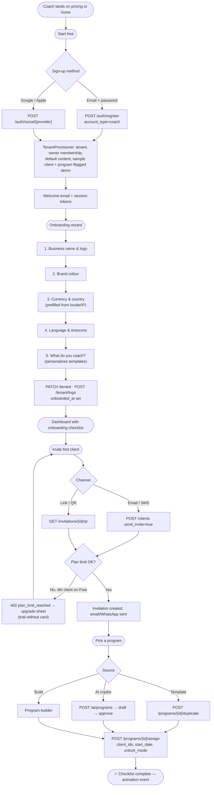
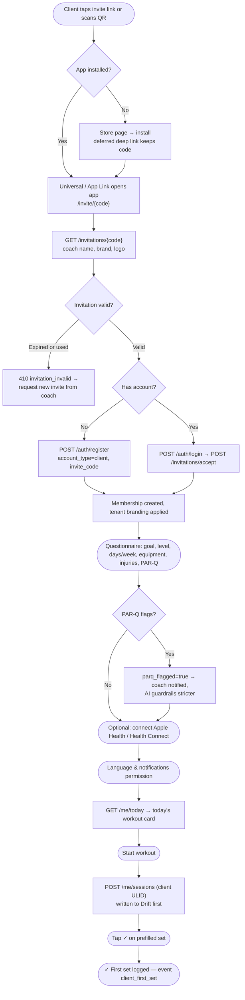
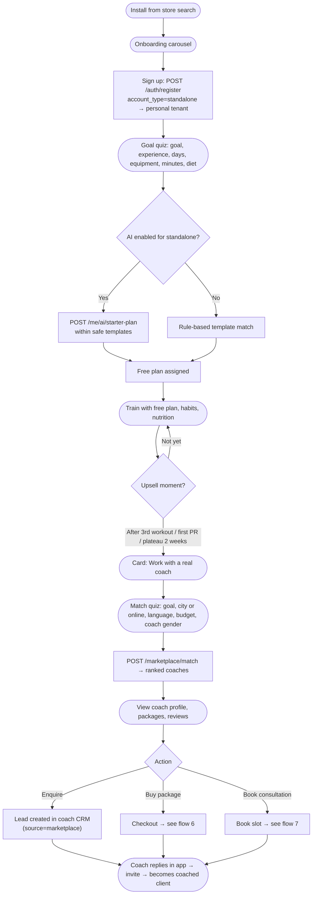
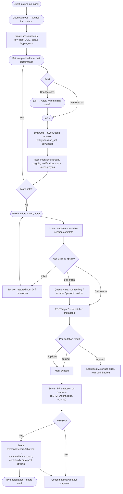
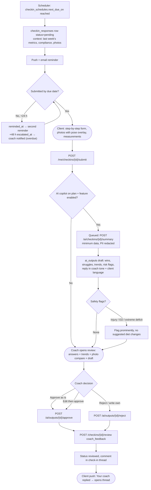
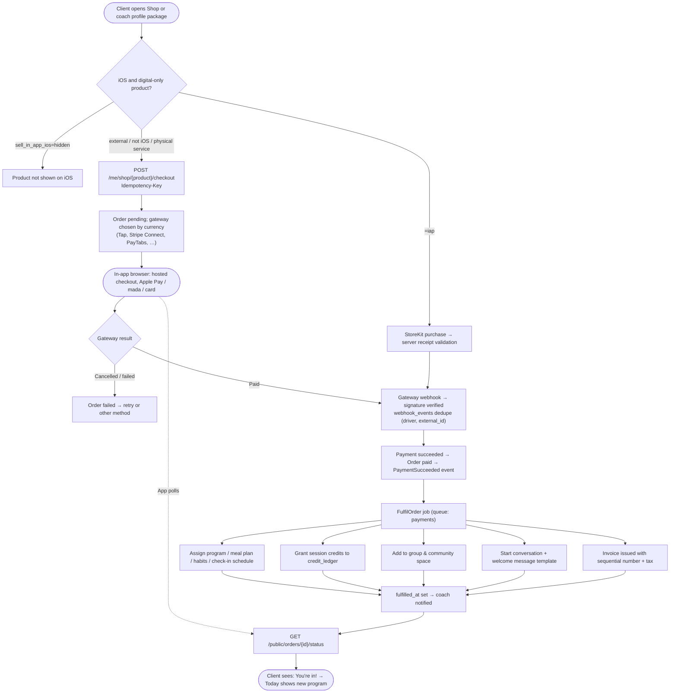
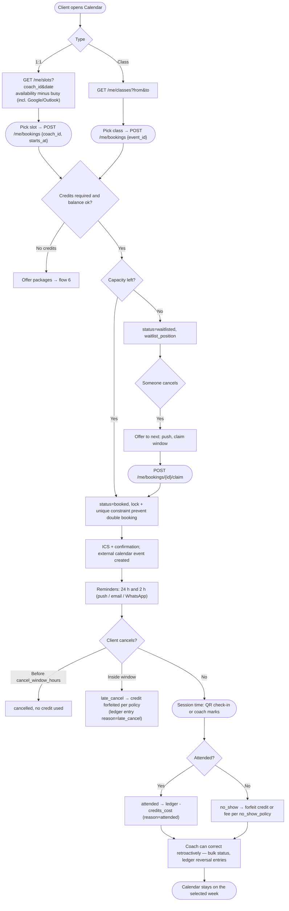
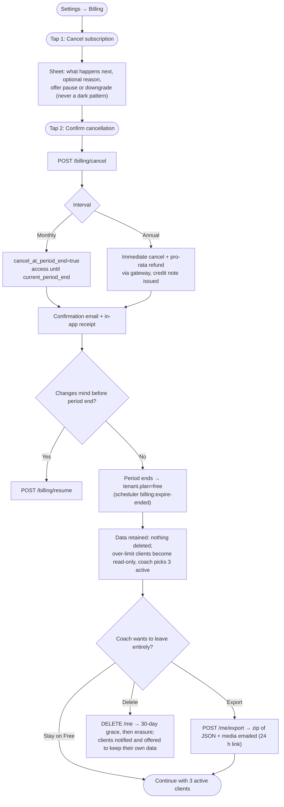

# User Flows

Eight critical journeys from Phase 0, each with its time target, the API calls behind every
step ([openapi.yaml](openapi.yaml)) and failure paths. Diagrams are Mermaid flowcharts.

Legend: rounded = user action · rectangle = system · diamond = decision · `API` labels name the endpoint.

---

## 1. Coach sign-up → onboarding → first client invite → first program assigned

**Target: < 5 minutes** (KPI: activation = first program **and** first invite within 24 h).

Failure paths: email already used → sign in / magic link offered; social token invalid → 422
with retry; logo upload fails → wizard continues with initials avatar.

---

## 2. Client invite acceptance → onboarding questionnaire → first workout logged

**Target: < 2 minutes** from tapping the invite to the first logged set.

---

## 3. Standalone client: install → goal quiz → free plan → "find a coach" upsell

---

## 4. Workout logging (offline) → sync → coach notified → PR celebration

Conflict policy: server timestamps; last-write-wins per field; session sets append-only;
re-sending the same set id is a no-op (`duplicate`).

---

## 5. Weekly check-in → AI summary → coach approves reply → client notified

Invariant: no AI text reaches the client without `ai_outputs.status in (approved, edited)` by a staff user.

---

## 6. Client buys package → payment → auto-assign content → welcome message

**Target: content assigned < 10 s after payment confirmation.**

Manual payments (`POST /manual-payments`) enter at "Payment succeeded" and run the same pipeline.

---

## 7. Booking a session → credit deduction → reminders → attendance → no-show rule

Ledger invariant: balance = Σ entries; corrections are new entries, never edits.

---

## 8. Coach cancels subscription (two taps) → confirmation → data retention → export

Retention policy: Free-plan tenants keep data indefinitely while active; tenants inactive for
24 months are warned 30 and 7 days before archival. See [SECURITY.md](SECURITY.md#4-privacy--data-protection).
